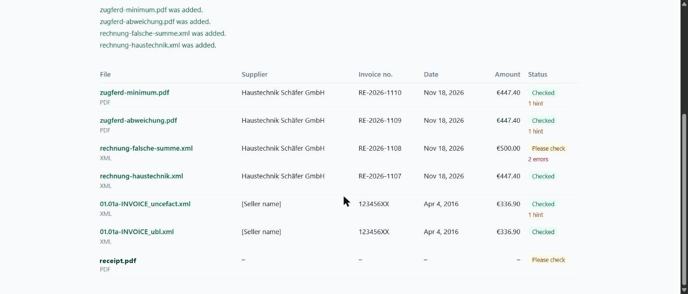
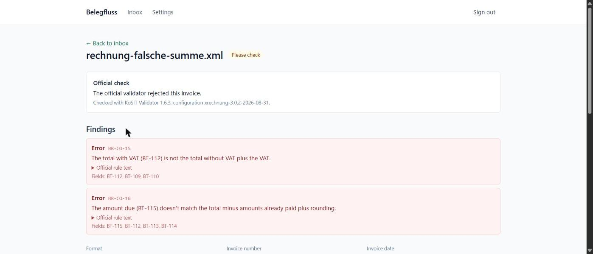
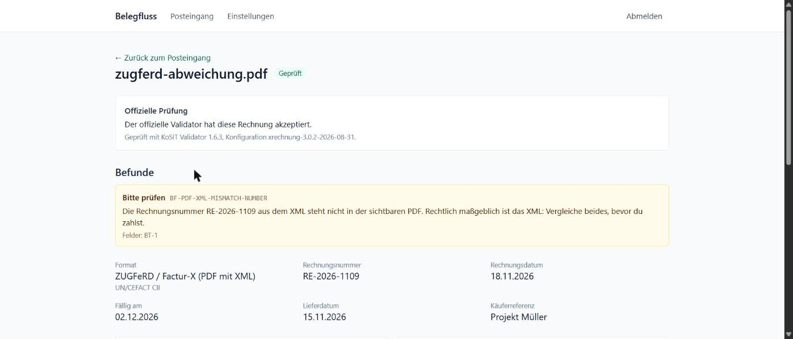
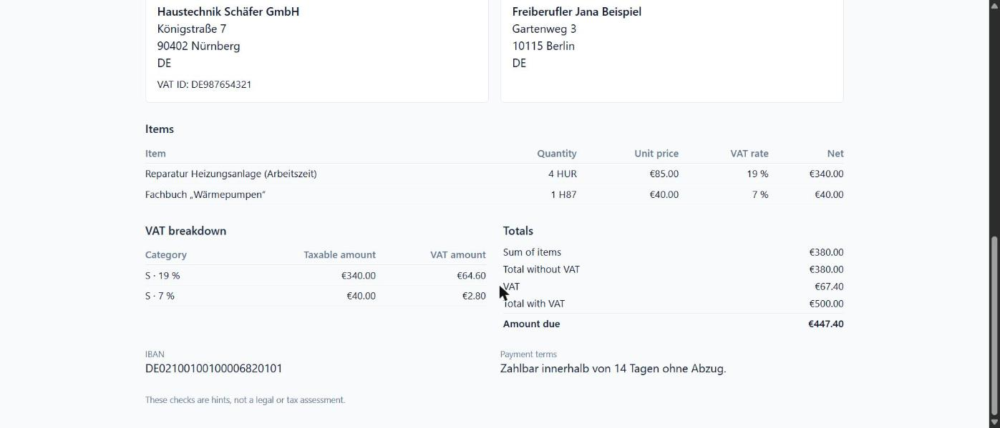
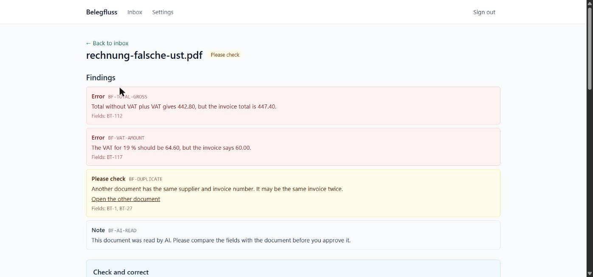
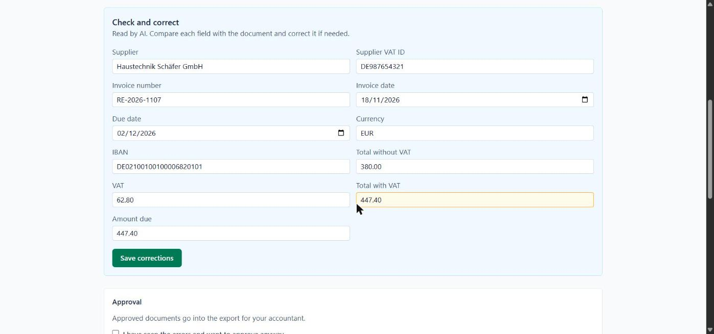

# Belegfluss

**A bilingual (German / English) e-invoice inbox for freelancers and small businesses in Germany.**

> **Status: M2b built (in review).** XRechnung and ZUGFeRD invoices are read exactly and checked by the official
> KoSIT validator. Plain PDFs and photos are read by AI (Azure OpenAI, EU Data Zone, keyless) and every value is
> checked by code before a person confirms it. Approved documents are exported for the accountant as a ZIP of the
> originals plus a CSV. Runs locally (Docker Compose), with CI on every change. Next: measuring extraction accuracy
> (M3). See [PLAN.md](PLAN.md), [M1](docs/milestones/M1.md), [M2a](docs/milestones/M2a.md) and
> [M2b](docs/milestones/M2b.md).

## The problem

Since **1 January 2025** every business in Germany must be able to **receive** structured e-invoices (XRechnung,
ZUGFeRD). Issuing them becomes mandatory step by step until **1 January 2028**
([research, F7–F10](docs/research/einvoicing.md#8-verified-facts)). Meanwhile the inbox stays mixed for years:
XML files that need extra viewer software to read, hybrid PDFs whose embedded XML is the legally leading part
(F15), plain PDFs, and photos of receipts. Many documents are exempt and will never be e-invoices (F11–F13).

*Our hypothesis, to be tested in [user interviews](docs/research/user-interviews.md):* freelancers and small
businesses still sort this mix and pass it to their accountant largely by hand, and they can't easily tell whether
an invoice is correct.

## What Belegfluss will do

1. Receive invoices: upload, later by email forwarding.
2. Read structured e-invoices (XRechnung UBL/CII, ZUGFeRD/Factur-X) **directly from the XML**.
3. Extract data from plain PDFs and images with an LLM pipeline. Every extracted field is checked by code, and
   uncertain fields go to a human review step.
4. Validate with the **official KoSIT validator** plus plain business checks (VAT maths, duplicates, missing
   fields, PDF-vs-XML mismatch), and explain problems in simple German or English.
5. Show a readable view of each invoice.
6. Export approved invoices for the accountant: originals + CSV first, more formats if accountants need them.
7. Dashboard: totals, VAT, open items, problems found.

Not in scope: sending invoices, payments, bookkeeping, tax advice.

## Screenshots (M2a and M2b, local, synthetic test invoices)

| | |
|---|---|
|  |  |
| Inbox: supplier, number, date, amount and status, read from the e-invoices | A wrong total: the official rules, explained in plain language |
|  |  |
| ZUGFeRD: the visible PDF shows a different invoice number than the XML (German) | The invoice as read from the XML |
|  |  |
| A plain PDF read by AI: the misprinted VAT is caught by code, not by the model | Every AI-read field can be checked and corrected before approval |

## Design

- [Architecture](docs/ARCHITECTURE.md): components, data flow, where the LLM is and isn't used, Azure services,
  security/GDPR boundaries
- [Decisions (ADRs)](docs/decisions/README.md)
- [E-invoicing research](docs/research/einvoicing.md): verified facts with official sources, and a hands-on run of
  the official validator ([evidence](docs/research/evidence/validator-smoke-2026-11-23.txt))
- [User interview guide](docs/research/user-interviews.md)

Planned stack: Next.js + TypeScript, FastAPI + PostgreSQL, KoSIT validator, Azure (Container Apps → AKS, Azure
OpenAI in the EU data zone, Blob/Queue, Key Vault, Managed Identity, Entra External ID), Terraform, GitHub Actions.

## How to run (local)

Requirements: Docker. For development without Docker: [uv](https://docs.astral.sh/uv/) and Node 24 with
Corepack (pnpm).

```bash
cp .env.example .env          # optional: sign-in values from docs/setup/entra-external-id.md
docker compose up --build     # web http://localhost:3000 · API http://localhost:8000/docs
```

Without the sign-in values the app runs, but shows "sign-in not configured". AI reading of plain PDFs and photos is
off by default; switching it on needs an Azure OpenAI resource ([setup](docs/setup/azure-openai-dev.md)).

| Part | Checks |
|---|---|
| API (`apps/api`) | `uv run ruff check . && uv run mypy src && uv run pytest` (tests start PostgreSQL 18 and Azurite containers) |
| Web (`apps/web`) | `pnpm lint && pnpm build && pnpm typecheck && pnpm test && pnpm test:e2e` |
| API contract | after an API change: `uv run python -m belegfluss.openapi_export ../web/src/api/openapi.json`, then `pnpm gen:api` |

CI runs all of this on every pull request, plus a Docker Compose smoke test and a secret scan.

## Results

No product results yet: extraction accuracy comes with M3, usage with M5. Every number published here links to
evidence. First live AI run: 4 synthetic documents read correctly at about $0.004 each
([evidence](docs/milestones/evidence/m2b-live-run-2026-11-24.md); not an accuracy measurement). Test results and
screenshots per milestone: [M1](docs/milestones/M1.md#test-results-evidence),
[M2a](docs/milestones/M2a.md#test-results-evidence), [M2b](docs/milestones/M2b.md#test-results-evidence).

## Project docs

[PLAN.md](PLAN.md) · [Project log](docs/PROJECT_LOG.md) · [Milestones](docs/milestones/) · [Costs](docs/COSTS.md) ·
[Third-party components](docs/THIRD_PARTY.md)

## Licence

To be decided before the repository is made public (planned with M4).
