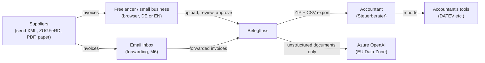
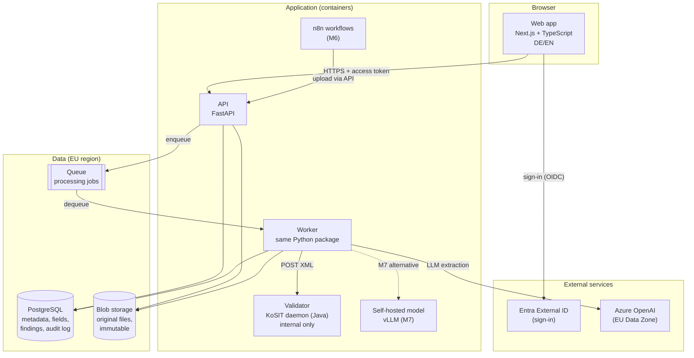
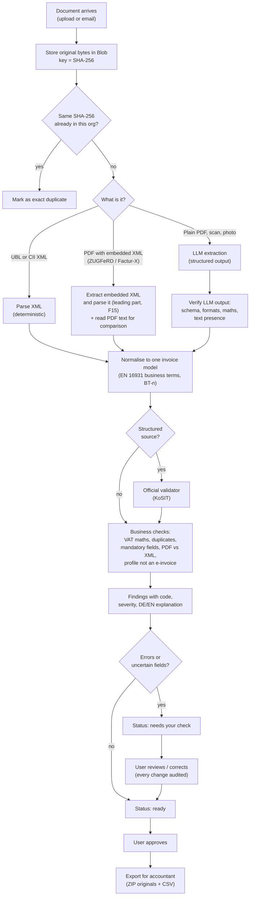
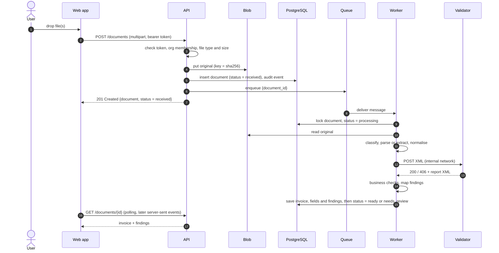
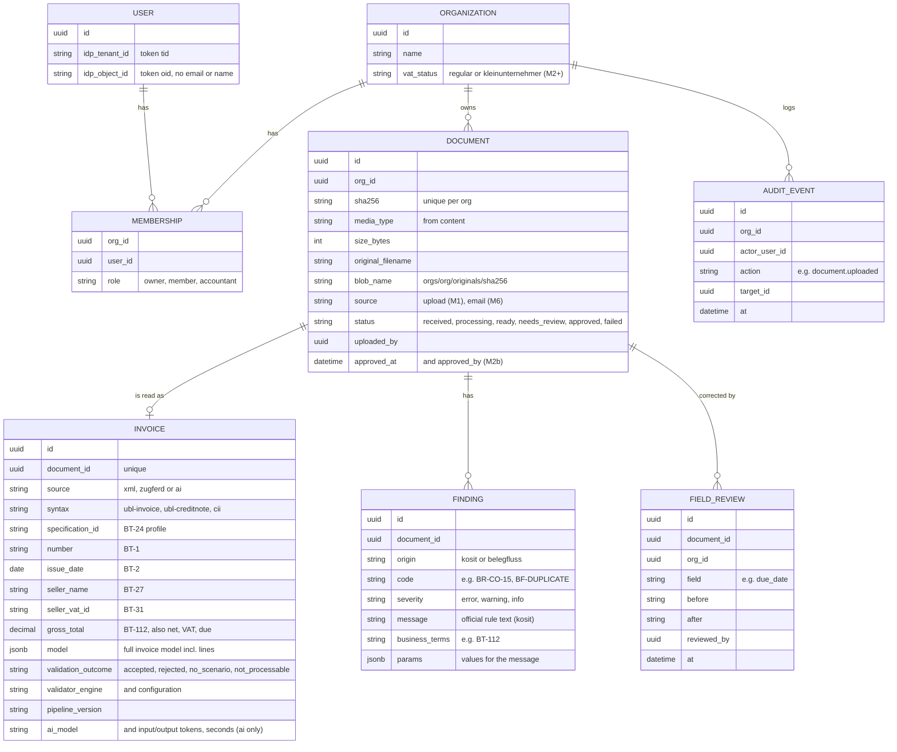
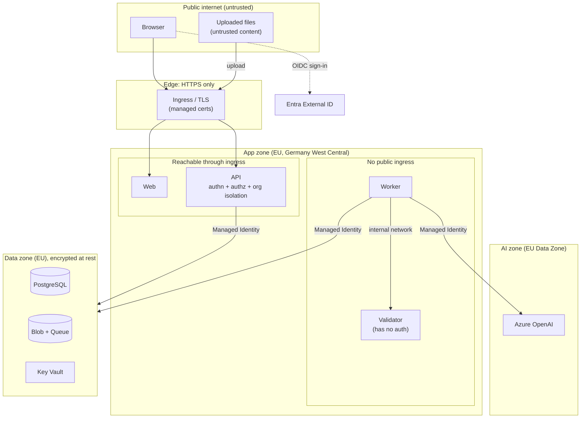
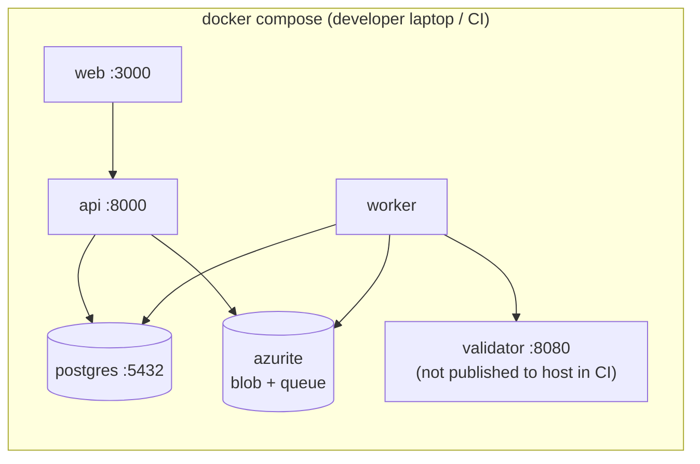
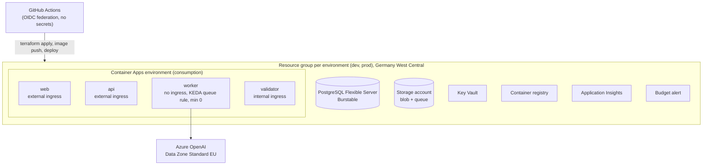
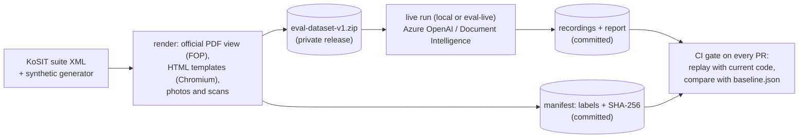

# Belegfluss — Architecture

> **Status:** agreed design from M0 (2026-11-23). It covers all milestones M1–M10. Decisions are recorded as ADRs in
> [`docs/decisions/`](decisions/): 0001–0009 accepted on 2026-11-23, 0010–0013 on 2026-11-24. Facts about e-invoicing come from
> [research/einvoicing.md](research/einvoicing.md) (fact IDs like F15).
> This document is kept current. When a milestone changes the design, it is updated together with a superseding ADR.
> **Built so far:** M1 (sign-in, organisations, upload, DE/EN, Compose, CI, [M1.md](milestones/M1.md)) and M2a (reading,
> official validation, worker, business checks, [M2a.md](milestones/M2a.md)). Sections marked "as built" describe the
> running code; the rest is design.

## 1. Goals and constraints

| Quality goal | What it means here |
|---|---|
| **Correct where it matters** | Legal-facing results (parsing, validation, totals, VAT) are **deterministic and tested**. The LLM is used only where no structured data exists, and its output is always checked |
| **Explainable** | Every problem shown to a user has a code, a plain-language explanation (DE/EN) and the field it refers to |
| **Privacy by design (GDPR)** | Invoices are personal and business data: EU region only, encryption, tenant isolation, audit log, deletion and export, no invoice content in logs |
| **Cheap to run** | Scale-to-zero where possible, smallest sensible SKUs, budget alerts. Target: a few euros per month in dev |
| **Simple code** | Small modules with one job, boring libraries, official tools instead of custom re-implementations |
| **Evolvable** | XRechnung 4.0 (expected spring 2027, F27), the transition deadlines in 2027/2028 and new export formats must not need a redesign |

Non-goals (for now): sending invoices, payments, bookkeeping (choosing accounts), tax advice, GoBD-certified archiving.

## 2. System context



## 3. Components



| Component | One job | Technology | From | Azure service (M4+) | AKS (M8) |
|---|---|---|---|---|---|
| Web app | UI: inbox, invoice view, review, export, settings; DE/EN | Next.js, TypeScript strict, typed API client generated from OpenAPI | M1 | Container Apps (external ingress) | Deployment + Ingress |
| API | Auth check, upload, read models, review/approve, export, deletion/export of user data | FastAPI, Pydantic v2, SQLAlchemy 2, Alembic | M1 | Container Apps (external ingress) | Deployment + Ingress |
| Worker | Process one document: classify → parse/extract → validate → check → save | Same Python package, different entrypoint | M2 | Container Apps, KEDA `azure-queue` scale rule, min 0 | Deployment + KEDA ScaledObject |
| Validator | Official XRechnung/EN 16931 validation | KoSIT validator v1.6.x daemon + official config, **no own code** | M2 | Container Apps, **internal ingress only** | Deployment + ClusterIP + NetworkPolicy |
| PostgreSQL | Source of truth for everything except file bytes | PostgreSQL | M1 | Database for PostgreSQL Flexible Server | same (managed, outside cluster) |
| Blob storage | Original files exactly as received (by SHA-256) | Azurite locally | M1 | Storage Account (Blob) | same |
| Queue | "Process document X" jobs | Azurite locally | M2 | Storage Account (Queue) | same |
| Identity | Sign-in, user accounts | Entra External ID (OIDC) | M1 | Entra External ID tenant | same |
| LLM | Extract fields from unstructured PDFs/images | Azure OpenAI, structured output | M2 | Azure OpenAI (Data Zone Standard, EU) | same |
| Secrets | The few secrets that Managed Identity can't replace | — | M4 | Key Vault | Key Vault + CSI driver |
| Telemetry | Traces, metrics, logs (no invoice content) | OpenTelemetry | M4/M5 | Application Insights / Azure Monitor | same |
| Automation | Email ingestion, scheduled exports, notifications | n8n (licence caveat, §10.9) | M6 | Container Apps | Deployment |
| Self-hosted model | Fine-tuned small model for extraction | vLLM (OpenAI-compatible API) | M7 | GPU VM or external GPU (cost decision) | GPU node pool (optional) |

## 4. Processing pipeline (one document)



Key rules:
- **The original file is never modified.** Everything else is derived data and can be recomputed (e.g. after a
  validator update).
- **Re-processing is safe**: the worker is idempotent per document and version (parser/validator/model version are
  stored with each result).
- **Nothing is exported unless a human approved it.**
- **An AI-read document always needs a person's check** (as built in M2b,
  [ADR-0016](decisions/0016-ai-extraction-azure-openai-verified-by-code.md)). Approving with open errors needs an
  explicit, audited acknowledgement ([ADR-0017](decisions/0017-review-approval-and-export.md)).

### 4.1 Upload → result (sequence)



Failure handling: if the enqueue fails after the DB insert, a **sweeper** re-enqueues documents stuck in `received`.
Messages that fail repeatedly go to a **poison queue** and the document is marked `failed` with a visible reason.

## 5. Where the LLM is used — and where it is NOT

| Task | LLM? | Why |
|---|---|---|
| Reading UBL / CII XML | **No** | Deterministic parsing is exact, testable and free |
| Reading ZUGFeRD | **No** (XML part) | The XML is the legally leading part (F15) |
| Validating format and business rules | **No** | Official KoSIT validator + our deterministic checks. Legal-facing |
| VAT maths, totals, duplicates, mandatory fields | **No** | Plain code with unit tests |
| Deciding "is this a valid e-invoice / is input VAT OK" | **No, never** | Not our role (no tax advice). The validator is not a legal prerequisite (F16) |
| Extracting fields from plain PDFs, scans, photos | **Yes** | No structured data exists. Output is schema-validated, checked, and uncertain fields go to human review |
| Explaining validator rule codes | **No for known codes** (curated DE/EN texts); **optional LLM fallback** for rare codes, using only the rule text, marked "AI-generated" | Explanations must be correct and reviewed |
| Writing SQL, changing data, calling tools | **No, never** | The LLM returns data only. Code decides what is stored |

**LLM safety rules:**
1. Invoice content is **untrusted input** (prompt injection is possible inside a PDF). The model has **no tools and
   no actions**. Its output must match a JSON schema and is then checked by code.
2. **Confidence comes from verification, not from the model's self-assessment.** A field is "uncertain" if it fails
   a check: format (IBAN checksum, VAT-ID pattern, dates), maths (net + VAT = gross per rate), presence (the
   extracted invoice number really appears in the PDF text layer), or plausibility (German VAT rates).
3. Only the document being processed is sent. Never other tenants' data, never user profile data.
4. EU processing only (Azure OpenAI Data Zone Standard EU, §11). Prompts are not used for training per Microsoft's
   data-privacy terms. Abuse-monitoring retention is a known caveat (§11).
5. One extraction interface with interchangeable providers: Azure OpenAI (M2), optional Document Intelligence
   baseline (M3), self-hosted vLLM (M7, OpenAI-compatible API). The M3 eval set compares them on equal terms.

## 6. Data model (sketch)

As built (M1, M2a, M2b): ORGANIZATION, USER, MEMBERSHIP, DOCUMENT, INVOICE, FINDING, FIELD_REVIEW and AUDIT_EVENT
with the fields shown here. Invoice lines and the VAT breakdown are part of the INVOICE's JSONB model, not tables
([ADR-0015](decisions/0015-store-results-as-summary-columns-plus-jsonb.md)). Exports are built on request and not
stored; an `export.created` audit event records them ([ADR-0017](decisions/0017-review-approval-and-export.md)).



Rules: every table that holds customer data has `org_id`. Every route that touches customer data is
`/orgs/{org_id}/…` and depends on one membership check; queries filter by `org_id` (and by `org_id` + `id` for a
single document). Cross-organisation access is tested ([ADR-0013](decisions/0013-tenancy-org-scoped-routes.md)). The
language choice is a browser cookie for now ([ADR-0010](decisions/0010-web-i18n-next-intl-without-url-locale.md)). PostgreSQL row-level security is considered as defence in depth in M9. The audit log is
append-only and holds **no invoice content**, only IDs and actions.

## 7. Security and GDPR boundaries



Every arrow into the data and AI zones uses Managed Identity (no keys). The validator is reachable only from the
worker.

| Concern | Control |
|---|---|
| Data residency | All resources in EU regions (Germany West Central planned; Azure OpenAI via the EU Data Zone). Entra External ID data location to be confirmed when creating the tenant (§11) |
| Authentication | Entra External ID (OIDC). API validates JWT signature, issuer, audience and expiry. No own password storage |
| Authorisation / tenant isolation | Membership check on every request; `org_id` required in the data-access layer; tests for cross-tenant access |
| Secrets | Managed Identity everywhere possible (DB, Blob, Queue, OpenAI). Key Vault for the rest. Nothing in git (`.env` ignored, `.env.example` documents variables). Secret scanning in CI |
| Untrusted files | Size/type limits; parse XML with a hardened parser (no external entities, no network); PDFs processed in the worker only; rendered invoice HTML is sandboxed (CSP, sandboxed iframe) because a JS-injection bug was found via attachment file names in the official visualisation (einvoicing §4.6) |
| Validator | Never reachable from outside (internal ingress / ClusterIP + NetworkPolicy), because it has no authentication (F36) |
| Logging | Structured logs with an allowlist of fields. **No invoice content, names, IBANs or file names** in logs or traces |
| Deletion & export (GDPR Art. 15/17/20) | "Export my data" (ZIP of originals + JSON) and "delete my organisation" (DB rows + blobs, then audit entry without content). Users are told that **they** must keep invoices 8 years (F18). Belegfluss is not their archive |
| Encryption | TLS in transit; Azure storage and PostgreSQL encrypted at rest by default (to be confirmed per service in M4) |
| Processor role | For pilot businesses, Belegfluss processes their supplier data as a **processor**. A data-processing agreement (AVV) template is needed before real users (M5) |
| Supply chain | Pinned dependencies, Dependabot, container image scanning, SBOM (M4/M9) |

## 8. Deployment views

### 8.1 M1–M3: local (Docker Compose)



Sign-in uses the real (free) Entra External ID dev tenant. Automated tests use locally signed test tokens, so CI
needs no internet login.

As built (M2a): `postgres`, `azurite`, `api`, `worker`, `validator` and `web`. Published ports are bound to 127.0.0.1;
the validator has no published port (reachable by the worker only, checked in CI).

As built (M2b), for live AI runs only: `compose.ai.yaml` stops the Compose worker and publishes the validator on
127.0.0.1:8081. The worker then runs on the host (`scripts/run-ai-worker.ps1`), signs in to Azure OpenAI with the
developer's `az login` (keyless) and calls the dev deployment (gpt-5.4-mini, Data Zone Standard EU, Germany West
Central, keys switched off). The default stack and CI make no AI calls ([setup](setup/azure-openai-dev.md)).

### 8.2 M4–M7: Azure Container Apps (Terraform)



### 8.3 M8: AKS (Helm)

Same images and the same managed data services. The difference is the runtime: AKS (free control-plane tier) with
a small node pool, Helm chart per component, KEDA for the worker, Workload Identity instead of Container Apps
managed identity, NetworkPolicy so that only the worker reaches the validator, rolling or canary updates, HPA for
api/web. Time-boxed with a cost cap (see [ADR-0007](decisions/0007-container-apps-first-aks-later.md)).

## 9. Repository layout (monorepo)

Folders are created **when the milestone needs them**, not up front ([ADR-0002](decisions/0002-plain-monorepo-layout.md)).

```text
belegfluss/
├── apps/
│   ├── web/                 # Next.js + TypeScript (M1)
│   └── api/                 # Python package "belegfluss": API + worker entrypoints (M1/M2)
├── services/
│   └── validator/           # Dockerfile + pinned official KoSIT config, no own code (M2)
├── infra/terraform/         # modules/ and envs/dev, envs/prod (M4)
├── deploy/helm/             # charts (M8)
├── automation/n8n/          # exported workflows (M6)
├── eval/                    # labelled-set manifest, eval runner, reports (M3)
├── ml/                      # fine-tuning code and configs (M7)
├── scripts/                 # e.g. fetch-test-data (pinned, checksummed) (M2)
├── docs/                    # this documentation
└── .github/workflows/       # CI/CD (M1)
```

## 10. Key decisions and options

Each row is detailed in an ADR. ✅ = recommended.

### 10.1 Monorepo layout → [ADR-0002](decisions/0002-plain-monorepo-layout.md)

| Option | Pros | Cons |
|---|---|---|
| ✅ Plain-folder monorepo, native tools (uv for Python, pnpm for web) | One PR per milestone covers web + API + infra; no extra tooling to learn or explain | No build caching across apps (not needed at this size) |
| Monorepo with Nx / Turborepo | Task caching, dependency graph | Extra complexity mainly for JS; little value for Python |
| Polyrepo (web, api, infra separately) | Clear boundaries | Cross-repo changes and versioning overhead for one developer |

### 10.2 Authentication → [ADR-0003](decisions/0003-auth-entra-external-id.md)

| Option | Pros | Cons |
|---|---|---|
| ✅ Microsoft Entra External ID | Azure-native CIAM; first 50,000 MAU free; email+password, one-time passcode, Google, Apple, custom OIDC; no password storage on our side; MSAL for the SPA, standard JWT validation in FastAPI | Vendor-specific setup; local dev needs internet. EU data location confirmed for our tenant (M1) |
| Azure AD B2C | Mature | **Not sold to new customers since 1 May 2025** |
| Own auth (fastapi-users or Auth.js + email magic links) | Full control, works offline | We store credentials or tokens and own the security risk; doesn't build Azure identity experience |
| Keycloak (self-hosted) | Open source, EU hosting under our control | One more stateful service to run, patch and back up |
| Auth0 / Clerk | Very easy | US vendors, extra GDPR assessment, cost at scale |

### 10.3 Background jobs → [ADR-0004](decisions/0004-jobs-storage-queue-with-db-status.md)

| Option | Pros | Cons |
|---|---|---|
| FastAPI BackgroundTasks | Zero infrastructure | Jobs are lost on restart; no retries; can't scale the worker separately |
| PostgreSQL as queue (`SKIP LOCKED`, e.g. procrastinate) | Transactional with the data (no dual write); one less service | Scaling the worker to zero needs a custom KEDA scaler; polling load on the DB |
| ✅ Azure Storage Queue (Azurite locally) + DB status as source of truth | Very cheap; native KEDA `azure-queue` scale rule in Container Apps and AKS (scale to zero); same code locally and in Azure | Dual write (DB + queue), handled by an idempotent worker + sweeper; max 64 KB messages (we only send IDs) |
| Azure Service Bus | Sessions, dead-lettering, topics | More than we need; Basic tier has no topics |
| Celery + Redis | Popular | Redis to operate; not Azure-native |

### 10.4 Running the Java validator → [ADR-0005](decisions/0005-validator-as-internal-daemon.md)

Options A–D are compared in [einvoicing.md §4.4](research/einvoicing.md#44-how-belegfluss-can-call-the-validator-from-python).
✅ **Daemon mode in its own internal-only container**, configuration pinned by version, several configurations side
by side when XRechnung 4.0 arrives. Verified by running it: 200 / 406 / 422 behaviour as documented (F35).

### 10.5 Processing and the LLM boundary → [ADR-0006](decisions/0006-deterministic-first-llm-boundary.md)

| Option | Pros | Cons |
|---|---|---|
| ✅ Deterministic first; LLM only for unstructured documents; verification-based confidence; human review | Exact where data exists; explainable; cheap | Two paths to maintain (XML and LLM) |
| LLM for everything (also XML) | One path | Wrong for legal data, costly, non-deterministic, ignores the leading XML (F15) |
| OCR + templates/rules only | No LLM cost | Brittle across layouts; weak for photos |
| Azure Document Intelligence prebuilt-invoice | Purpose-built, German supported | Field set fixed; cost; less learning value. Kept as an **eval baseline** in M3 |

### 10.6 Hosting path: Container Apps vs AKS → [ADR-0007](decisions/0007-container-apps-first-aks-later.md)

| Option | Pros | Cons |
|---|---|---|
| ✅ Container Apps in M4, migrate to AKS in M8 (time-boxed) | Cheapest way to be live early (scale to zero, free monthly grant); AKS skills are added later on a working system; a real migration story | Two runtimes to learn; Helm charts written in M8 |
| AKS from M4 | Kubernetes from day one | Always-on node cost; slower to first production; more ops before any user |
| App Service | Simple PaaS | Weak fit for queue workers and the validator sidecar; no Kubernetes story |

### 10.7 Test data → [ADR-0008](decisions/0008-test-data-sourcing-and-licensing.md)

✅ Fetch pinned official suites by script with SHA-256 (not vendored); generate our own ZUGFeRD and synthetic
invoices; never commit FeRD samples (no redistribution licence, F44); build a labelled PDF set from official XML
(ground truth) for M3.

### 10.8 Accountant export → [ADR-0009](decisions/0009-accountant-export-zip-and-csv-first.md)

✅ ZIP of originals + CSV summary first. DATEV-Format (EXTF) only if accountants ask, because it needs their account
numbers and Berater/Mandant numbers (F46). DATEV APIs not before real demand.

### 10.9 Smaller choices (decided in their milestone, listed here so nothing is hidden)

| Topic | Options | Current leaning | Decide in |
|---|---|---|---|
| i18n in Next.js | next-intl · i18next · built-in routing only | **Decided:** next-intl without locale in the URL | [ADR-0010](decisions/0010-web-i18n-next-intl-without-url-locale.md) |
| Typed API client | openapi-typescript + openapi-fetch · orval · hand-written | **Decided:** openapi-typescript + openapi-fetch, CI drift check | [ADR-0011](decisions/0011-typed-api-contract-openapi.md) |
| XML parsing | own lxml mapping for UBL and CII · official KoSIT visualisation step-1 XSLT (UBL/CII → one semantic model) via Saxon | **Decided:** official transform via saxonche (spike: 86/86 files, 0 mismatches) | [ADR-0014](decisions/0014-read-xml-with-official-kosit-transform.md) |
| Live updates in UI | polling · server-sent events · WebSockets | **Built (M2a):** polling every 2 s while documents are processing; SSE later if needed | M2a |
| Container registry | Azure Container Registry · GitHub Container Registry | ACR (Azure story, Managed Identity pull) — check cost | M4 ADR |
| Terraform state | Azure Storage backend · Terraform Cloud | Azure Storage backend with state locking | M4 ADR |
| Email ingestion (M6) | n8n IMAP/webhook workflow · own small ingestion service · inbound-email provider webhook | **Open.** n8n's Sustainable Use License allows use "for your own internal business purposes" and free non-commercial distribution. Using it for a customer-facing feature is unclear if Belegfluss ever charges. Option: n8n for internal workflows (exports, notifications), own code for ingestion | M6 ADR |
| Fine-tuned model (M7) | small open vision-language model + LoRA; served with vLLM | choose model by licence + size against the M3 eval set | M7 ADR |

### 10.10 AI extraction → [ADR-0016](decisions/0016-ai-extraction-azure-openai-verified-by-code.md) (M2b)

| Option | For | Against |
|---|---|---|
| ✅ Azure OpenAI gpt-5.4-mini, Data Zone Standard EU, page images + text layer, structured outputs, keyless, verified by code | Reads photos and scans; values checked by arithmetic, formats and presence in the text layer; no key to leak | Costs per token (measured $0.0043 per document); model retires 2027-09-21 |
| gpt-5-mini (the plan) | About 2.5× cheaper per token | **0 EU Data Zone quota** in this subscription (checked 2026-11-24) |
| Document Intelligence `prebuilt-invoice` | Purpose-built | Fixed field set, $10 per 1,000 pages: **M3 baseline** |
| Global Standard deployment | Quota available, cheaper | May process outside the EU |

### 10.11 Review, approval and export → [ADR-0017](decisions/0017-review-approval-and-export.md) (M2b)

✅ Corrections only for AI-read invoices (the XML is legally leading), each stored as before/after in `field_reviews`.
Approval with open errors needs an explicit, audited acknowledgement. The export contains approved documents only,
originals byte-identical, plus a German-Excel CSV; it is built on request and not stored.

### 10.12 Evaluation and the CI gate → [ADR-0018](decisions/0018-evaluation-dataset-metrics-and-gate.md) (M3)



✅ Official renders + synthetic layouts + photo/scan variants (206 documents, split by source into dev 79 / test 127);
strict field metrics with confidence intervals; the PR gate replays recorded answers (free, no secrets) and
requires a new live run when the prompt fingerprint or the dataset changes. Live runs from GitHub sign in with OIDC
and a user-assigned managed identity that trusts only the `eval` environment on `main`
([ADR-0019](decisions/0019-ci-to-azure-with-oidc-managed-identity.md)).

## 11. Azure facts checked in M0

| Fact | Source | Status |
|---|---|---|
| Entra External ID is Microsoft's CIAM solution; Azure AD B2C not sold to new customers since 1 May 2025 | [External ID overview](https://learn.microsoft.com/en-us/entra/external-id/customers/overview-customers-ciam), [B2C overview](https://learn.microsoft.com/en-us/azure/active-directory-b2c/overview) | ✅ |
| External ID: first 50,000 MAU free | [pricing](https://azure.microsoft.com/en-us/pricing/details/microsoft-entra-external-id/) | ✅ |
| External tenant country/region is chosen at creation and can't be changed; Entra stores most data in the EU Data Boundary for EU tenants, but **external tenant locations "may differ"** | [create external tenant](https://learn.microsoft.com/en-us/entra/external-id/customers/how-to-create-external-tenant-portal), [data residency](https://learn.microsoft.com/en-us/entra/fundamentals/data-residency), [EU storage](https://learn.microsoft.com/en-us/entra/fundamentals/data-storage-eu) | ✅ confirmed for our tenant on 2026-11-24: Germany, "EU Model Clause compliant datacenters", `tenant_region_scope: EU` |
| Container Apps scale to zero (no usage charges at zero); event-driven jobs and `azure-queue` scaler | [scaling](https://learn.microsoft.com/en-us/azure/container-apps/scale-app), [jobs](https://learn.microsoft.com/en-us/azure/container-apps/jobs) | ✅ |
| Container Apps free grant per subscription/month: 180,000 vCPU-s, 360,000 GiB-s, 2M requests | [pricing](https://azure.microsoft.com/en-us/pricing/details/container-apps/) | ✅ |
| Azure OpenAI "Data Zone Standard" processes data only within the EU data zone | [deployment types](https://learn.microsoft.com/en-us/azure/foundry/foundry-models/concepts/deployment-types) | ✅ |
| Which GPT models are available as Data Zone Standard EU and in which regions | [region availability](https://learn.microsoft.com/en-us/azure/foundry/foundry-models/concepts/models-sold-directly-by-azure-region-availability) (updated 2026-10-19) | ✅ 2026-11-24: gpt-5-mini, gpt-4.1-mini, gpt-5-nano, gpt-5.4-mini in Germany West Central and Sweden Central (among others) |
| **Offered ≠ usable:** quota is per subscription and region. This subscription (pay-as-you-go) had 0 Data Zone Standard quota for gpt-5-mini in 7 EU regions, but 200 for gpt-5.4-mini in Germany West Central | `az cognitiveservices usage list` (2026-11-24) | ✅ checked in M2b |
| Entra ID sign-in to Azure OpenAI needs a custom subdomain, which can't be changed later; key access can be switched off (`disableLocalAuth`) | [custom subdomains](https://learn.microsoft.com/en-us/azure/ai-services/cognitive-services-custom-subdomains), [disable local auth](https://learn.microsoft.com/en-us/azure/ai-services/disable-local-auth) | ✅ checked in M2b (read back on the dev resource) |
| Prompts/completions not used to train foundation models; abuse monitoring may store data (EEA reviewers for EEA deployments) | [data privacy](https://learn.microsoft.com/en-us/azure/foundry/responsible-ai/openai/data-privacy) | ✅ |
| PostgreSQL Flexible Server smallest Burstable is B1ms; Burstable "not recommended for production" | [compute options](https://learn.microsoft.com/en-us/azure/postgresql/flexible-server/concepts-compute-storage) | ✅ (price ❌) |
| Document Intelligence `prebuilt-invoice` exists and supports German | [invoice model](https://learn.microsoft.com/en-us/azure/ai-services/document-intelligence/prebuilt/invoice), [languages](https://learn.microsoft.com/en-us/azure/ai-services/document-intelligence/language-support/prebuilt) | ✅ (price ❌) |
| Storage Queue messages ≤ 64 KB; Service Bus Basic has no topics | [queue pricing](https://azure.microsoft.com/en-us/pricing/details/storage/queues/), [Service Bus pricing](https://azure.microsoft.com/en-us/pricing/details/service-bus/) | ✅ |
| n8n Sustainable Use License terms | [LICENSE.md](https://github.com/n8n-io/n8n/blob/master/LICENSE.md) | ✅ (interpretation ⚠️) |
| AKS has a Free control-plane tier (dev/test, < 10 nodes recommended, no uptime SLA); nodes are paid | [AKS pricing tiers](https://learn.microsoft.com/en-us/azure/aks/free-standard-pricing-tiers) | ✅ |
| Container Apps offer free managed certificates for custom domains, **but the app must be publicly reachable and running during issuance and renewal**, which affects scale-to-zero for the web app | [custom domains + managed certificates](https://learn.microsoft.com/en-us/azure/container-apps/custom-domains-managed-certificates) | ✅ (caveat for M4) |
| Azurite emulates Blob, Queue and Table (Table in preview) locally | [Azurite](https://learn.microsoft.com/en-us/azure/storage/common/storage-use-azurite) | ✅ |
| vLLM provides an OpenAI-compatible server (chat completions, `vllm serve`) | [vLLM docs](https://docs.vllm.ai/en/stable/getting_started/quickstart/) | ✅ (check vision-model support in M7) |

Prices did not render on the Azure pricing pages. **Every cost is estimated with the Azure pricing calculator and
recorded in [COSTS.md](COSTS.md) before deploying (M4).**

## 12. What this architecture deliberately does not do (yet)

- No microservices beyond what has a clear reason (the validator is separate because it is Java and unauthenticated;
  the worker is separate because it scales differently).
- No event sourcing, no CQRS, no service mesh.
- No GoBD-certified archive. Users keep their originals (F18, F19).
- No sending of invoices, no Peppol access point (possible future option, not in scope).
