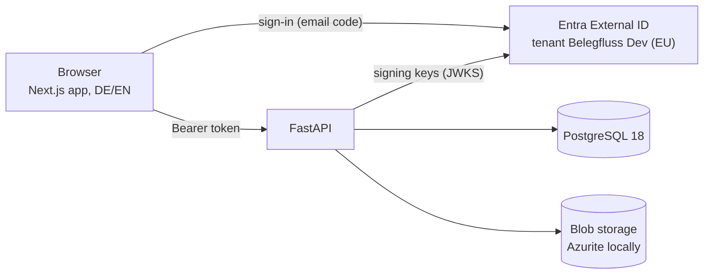
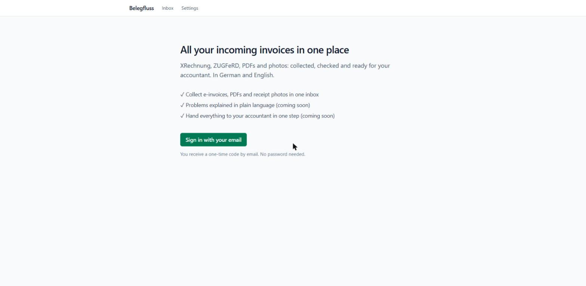
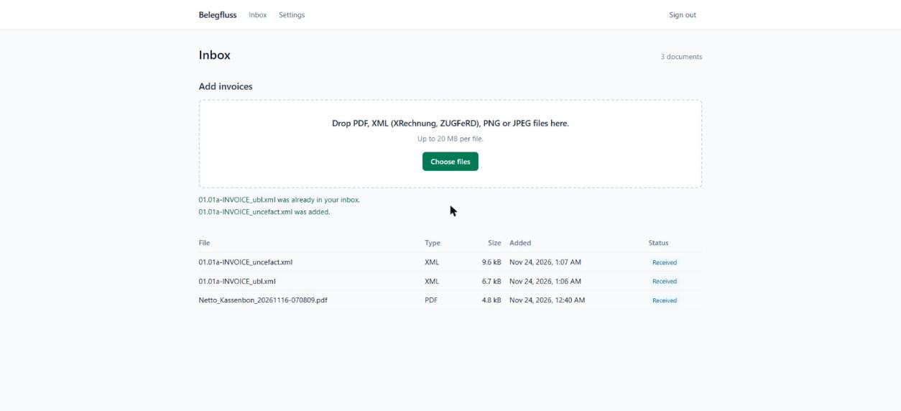
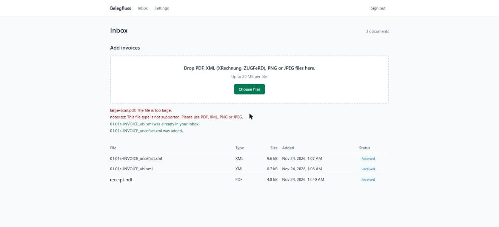
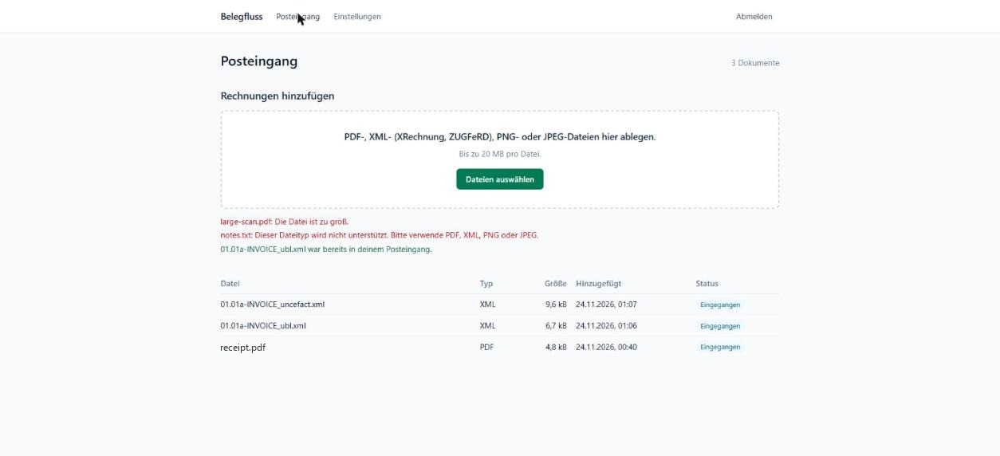

# M1 — Local foundation

> Dates: 2026-11-23 to 2026-11-24 · Branch: `m1-local-foundation` · [PR #2](https://github.com/LomadaDharmateja/belegfluss/pull/2)
> Plan: [PLAN.md → M1](../../PLAN.md#m1--local-foundation) · Diary: [PROJECT_LOG.md](../PROJECT_LOG.md)

## Like I'm 10

We built the empty shop before filling the shelves. There is a website where you log in with your email: you get a
code, type it in, and you're in. No password to forget. Each person gets their own private drawer, and nobody else
can open it. You can drop your bills into the drawer: the app checks that they really are bills (PDF, XML, photo),
keeps an exact copy and notices when you drop the same bill twice. Everything speaks German or English, whichever you
like. A robot checks all of this every time we change something, so we notice right away if we break it. The app
can't read the bills yet. That's the next step.

## Technical

### What runs

| Part | What it does | Key files |
|---|---|---|
| Sign-in (web) | MSAL React, authorization code + PKCE, no client secret. Tokens in session storage (gone when the tab closes) | `apps/web/src/auth/AuthProvider.tsx`, `config.ts`, `useApiClient.ts` |
| Token check (API) | RS256 signature against the tenant's JWKS, exact issuer, audience = API client ID, scope `access_as_user`, `exp`/`tid`/`oid` required. Stable error codes (`auth.*`) | `apps/api/src/belegfluss/auth.py` |
| Organisations | First sign-in creates the user (only `tid` + `oid`) and a personal organisation with the user as owner. Every customer-data route is `/orgs/{org_id}/…` and depends on `require_membership`; non-members get 404 | `tenancy.py`, `routes/me.py`, [ADR-0013](../decisions/0013-tenancy-org-scoped-routes.md) |
| Upload | Size limit (20 MB), type from the file's content (PDF, XML, PNG, JPEG), SHA-256, original stored unchanged at `orgs/{org}/originals/{sha256}`, duplicate per organisation returns the existing document, audit event without file name | `uploads.py`, `storage.py`, `routes/documents.py`, `audit.py` |
| Database | SQLAlchemy 2.1 (sync) + psycopg 3, Alembic migration applied on start | `models.py`, `migrations/`, [ADR-0012](../decisions/0012-persistence-sync-sqlalchemy-and-real-db-tests.md) |
| API contract | FastAPI writes `openapi.json`; TypeScript types are generated from it; CI fails on drift | `openapi_export.py`, `apps/web/src/api/`, [ADR-0011](../decisions/0011-typed-api-contract-openapi.md) |
| Languages | next-intl, language from a cookie or the browser, not in the URL. Server errors are codes, translated in the web app | `apps/web/messages/*.json`, `src/i18n/`, [ADR-0010](../decisions/0010-web-i18n-next-intl-without-url-locale.md) |
| Local stack | `docker compose up --build`: PostgreSQL, Azurite, API, web; ports bound to 127.0.0.1 | `compose.yaml`, `apps/*/Dockerfile` |
| CI | API (ruff, mypy strict, pytest), web (contract drift, lint, build, types, Vitest, Playwright), Docker Compose smoke test, gitleaks; actions pinned by commit SHA; Dependabot | `.github/workflows/`, `.github/dependabot.yml` |

### Test results (evidence)

| Check | Result | Evidence |
|---|---|---|
| API: ruff, format, mypy strict, pytest | 63 passed in 29.9 s (real PostgreSQL 18 + Azurite via testcontainers) | local run 2026-11-24; CI [api](https://github.com/LomadaDharmateja/belegfluss/actions/runs/45302955410) |
| Web: lint, types, Vitest, Playwright | 28 unit + 5 browser tests passed | local run 2026-11-24; CI [web](https://github.com/LomadaDharmateja/belegfluss/actions/runs/45302955414) |
| Docker Compose smoke | all services healthy; `/health` 200, `/me` 401, DE and EN pages | CI [compose-smoke](https://github.com/LomadaDharmateja/belegfluss/actions/runs/45302955388) |
| Secret scan | no findings | CI [secret-scan](https://github.com/LomadaDharmateja/belegfluss/actions/runs/45302955469) |
| Real sign-in and upload | real token accepted (`/me` 200, upload 201); stored blob's SHA-256 matches the database | [PROJECT_LOG 2026-11-24 (B2)](../PROJECT_LOG.md) |
| Manual walkthrough | official XRechnung test invoices (UBL + CII) added, duplicate recognised (200), `.txt` rejected (415), 21 MiB rejected in the browser, German and English | screenshots below, [PROJECT_LOG (B3)](../PROJECT_LOG.md) |

Screenshots (`evidence/`):

| | |
|---|---|
|  |  |
| Landing page (English, not signed in) | Inbox: CII test invoice added, UBL file recognised as duplicate |
|  |  |
| Too large and unsupported file, translated server error | The same in German: dates, decimal comma, status |

### Changes from the plan

- **TypeScript 5.9, not 6.0.3; ESLint 9, not 10.** openapi-typescript declares TypeScript 5 as a peer dependency,
  and several lint plugins don't support ESLint 10 yet.
- **User key is `tid` + `oid`, not the token subject.** ADR-0003 said "token subject"; Microsoft names `oid` as the
  stable user ID. Recorded in [ADR-0013](../decisions/0013-tenancy-org-scoped-routes.md) and noted in ADR-0003.
- **Extra setting `ENTRA_TENANT_ID`.** The tenant publishes its issuer on `<tenant-id>.ciamlogin.com`; MSAL only
  accepts it when that host is a known authority (see "What broke").
- **Organisation check as a route dependency, not a separate data-access layer.** The plan said "data-access layer
  that requires `org_id`". Every customer-data route has `{org_id}` in its path and one membership dependency, and
  queries filter by `org_id` ([ADR-0013](../decisions/0013-tenancy-org-scoped-routes.md)). Same guarantee, one layer
  less.
- **Pre-commit is lighter than planned.** It runs whitespace/YAML checks, ruff and gitleaks. mypy, ESLint and the
  TypeScript check run in CI only, because they need the full environments. Prettier was not added: ruff formats the
  Python code, and the web code follows the Next.js ESLint rules.
- **No `logging.py` yet.** The app writes no logs of its own. The access log has method, path and status only, and
  contained no file names in the manual runs. Structured logging (with a test that no file names or invoice content
  are logged) comes with Application Insights in M5.

### What broke and what I learned

1. **App registrations in the wrong directory.** The Azure portal and the Entra admin center each remember their own
   directory. The apps were first registered in the personal Default Directory. Found by a read-only check, redone in
   the external tenant, leftovers deleted, and the setup guide now has a "check the directory label" step.
2. **Sign-in button did nothing.** The console showed `endpoints_resolution_error`. In the msal-common 16.17 source
   (`Authority.validateIssuer`) the issuer must match the sign-in host, a CIAM name pattern, or a known authority.
   Our tenant's issuer is tenant-ID based, so none matched. Fix: list both hosts. Regression test first.
3. **"Uploading …" stayed on screen after the upload finished.** Only one request reached the API; the line was just
   never replaced. Fixed with a regression test.
4. **Process slips (mine):** a chained `sed` + commit once committed a broken file, and a chained log update failed
   while the commit went through. Both were fixed in follow-up commits. Checks and commits now run as separate steps.

### What M1 can and cannot do

- **Can:** sign in with an email code; personal organisation; upload and list originals with exact-duplicate
  detection; content-based type check and size limit; audit of uploads; German and English; whole stack with one
  command; CI on every pull request.
- **Cannot yet:** read or validate invoices, queue/worker (M2); delete or export a document (M2); several members
  per organisation or accountant access (M6); email intake (M6); hosting (M4); virus scanning (M9); Content Security
  Policy header (M9; the other security headers are set).

## For interviews

**Say it in 7 sentences:**
1. "M1 is the foundation: a FastAPI service and a Next.js app in one repo, with PostgreSQL and blob storage, started
   with one Docker Compose command, and CI that checks every pull request."
2. "Sign-in uses Microsoft Entra External ID with email one-time codes, so I store no passwords. The browser gets an
   access token with MSAL and PKCE, and the API checks signature, issuer, audience, scope and expiry on every call."
3. "Multi-tenancy is explicit: every customer-data route has the organisation in its path and one membership
   dependency. Non-members get a 404, and tests actively try to read and write another organisation's data."
4. "Uploads are checked by content, not by file name, hashed with SHA-256, stored unchanged and deduplicated per
   organisation. The database keeps only the two IDs from the identity provider, no email or name."
5. "The OpenAPI schema is the contract. The TypeScript types are generated from it, and CI fails if the two sides
   drift."
6. "Tests run against real PostgreSQL and the Azure storage emulator in containers, including a migration
   round-trip and a check that the models match the migrations."
7. "The first real sign-in failed silently. I read the browser console and the MSAL source, found that the tenant's
   issuer uses a tenant-ID host that MSAL only trusts when it's configured, wrote a failing test, fixed it and
   verified the redirect."

**Likely questions and good answers:**

- **Why Entra External ID and not your own login?** A password database is a liability for an app with financial
  documents. External ID is free for the first 50,000 monthly users, Azure-native, and the API only depends on
  standard OIDC/JWT validation, so lock-in is small. The fallback (Keycloak) is recorded in ADR-0003.
- **How do you test authentication without a real tenant?** The verifier takes an injectable key source. Tests sign
  tokens with a local RSA key and check every rejection path: expired, wrong audience, wrong issuer, missing scope,
  missing claims. There is no "skip auth" switch in application code.
- **Why 404 and not 403 for another organisation?** A 403 would confirm that the organisation exists. With 404, an
  attacker learns nothing. Document queries filter by organisation *and* ID, so a valid document ID from elsewhere is
  also a 404.
- **What if two identical uploads arrive at the same time?** A unique constraint on (organisation, SHA-256) decides.
  The loser catches the integrity error and returns the winner as a duplicate, so no double rows and no 500.
- **Why trust the content and not the extension?** Extensions are just names. The API reads the first bytes: PDF
  and image signatures, and for XML a pattern that rejects HTML. A renamed `.txt` gets a 415.
- **Why sync SQLAlchemy?** At pilot scale async adds complexity without benefit. FastAPI runs sync endpoints in a
  thread pool. If concurrency ever becomes the bottleneck, I'd tune workers and replicas first (ADR-0012).
- **Where are tokens kept, and is that safe?** In session storage, so they disappear when the tab closes. Any
  browser storage is readable by injected script, so the defence is preventing script injection: React escapes
  output, and a Content Security Policy is planned for M9.
- **What went wrong?** App registrations landed in the wrong directory, and the first sign-in failed on issuer
  validation. Both were found by checking, not guessing, fixed with tests, and written down in the project log.

## Claims audit (end of M1)

Scope: README, ARCHITECTURE (M1 parts), ADRs 0003 and 0010–0013, the setup guide, COSTS.md and this document.

| # | Claim | Where | Status | Evidence / action |
|---|---|---|---|---|
| 1 | Sign-in with email one-time code works end to end | README, M1 | ✅ confirmed | Real sign-in 2026-11-24 (PROJECT_LOG B2), screenshots |
| 2 | Tenant data is stored in the EU | ADR-0003, ARCHITECTURE §11 | ✅ confirmed | Portal: country Germany, "EU Model Clause compliant datacenters"; discovery document `tenant_region_scope: EU`. *Fixed during audit:* ADR-0003 condition marked as met |
| 3 | API checks signature, issuer, audience, scope, expiry | M1, ADR-0003 | ✅ confirmed | `test_auth.py` (12 tests); real token accepted |
| 4 | Other organisations can't list, read or upload | ADR-0013, M1 | ✅ confirmed | `test_tenant_isolation.py` (6 tests) |
| 5 | File type comes from the content | README, M1 | ✅ confirmed | `test_uploads_unit.py`; manual run: `.txt` → 415 |
| 6 | Originals are stored unchanged; duplicates recognised per organisation | M1 | ✅ confirmed | Recomputed SHA-256 equals the database value; duplicate → 200, no new row |
| 7 | Only `tid` + `oid` are stored about a user, no email or name | M1, ADR-0013 | ✅ confirmed | `users` table has 4 columns: id, idp_tenant_id, idp_object_id, created_at |
| 8 | No file names or invoice content in logs | M1, ARCHITECTURE §7 | ⚠️ caveat | True today: the app has no logger, and the API log had 0 file-name matches in the manual runs. No automated test yet; planned with structured logging in M5 |
| 9 | 63 API tests, 28 unit + 5 browser tests pass | M1, PR | ✅ confirmed | Local runs 2026-11-24, CI runs linked above |
| 10 | API suite takes about 30 s | ADR-0012 | ⚠️ caveat | 29.9 s in one run on the dev laptop. *Fixed during audit:* was "~10–30 s" |
| 11 | One command starts the stack | README | ✅ confirmed | compose-smoke CI run; local runs |
| 12 | Actions pinned by SHA; gitleaks binary pinned by checksum | M1 | ✅ confirmed | `.github/workflows/*.yml` |
| 13 | External ID is free for the first 50,000 monthly active users | README, ADR-0003, setup guide | ✅ confirmed | [Microsoft Learn pricing](https://learn.microsoft.com/en-us/entra/external-id/external-identities-pricing) |
| 14 | M1 cloud cost is €0, budget alert at €10/month | COSTS | ✅ confirmed | Portal 2026-11-24: current cost €0.00; budget with 50/100 % actual and 100 % forecast alerts |
| 15 | Azure for Students restricts regions and isn't suited for this project | setup guide | ⚠️ caveat | Offer terms and the Cost Management table are official pages; the region rule comes from a Microsoft staff answer on Tech Community (2025) |
| 16 | MSAL accepts a different issuer host only via known authorities | M1, ADR-0003 | ✅ confirmed | msal-common 16.17 source (`Authority.validateIssuer`); failure reproduced and fixed |
| 17 | New API registrations in the external tenant use access-token version 2 | setup guide | ✅ confirmed | Manifest showed `requestedAccessTokenVersion: 2` on 2026-11-24 |
| 18 | openapi-fetch is about 6 kB | ADR-0011 | ⚠️ caveat | Its README says 6 kB; measured 0.17 build: 17 kB raw, 4.4 kB gzipped. *Fixed during audit:* ADR states the measurement |
| 19 | Next.js 16 Cache Components are opt-in, default in the next major version | ADR-0010 | ✅ confirmed | Bundled Next.js docs (`cacheComponents`) read 2026-11-23 |
| 20 | Language cookie lasts one year; DE/EN keys, placeholders and error codes are tested | ADR-0010 | ✅ confirmed | `src/i18n/actions.ts`, `messages.test.ts` (4 tests) |
| 21 | User identity = token subject | ADR-0003 | ❌ wrong | *Fixed during audit:* implementation note in ADR-0003 → `tid` + `oid` (ADR-0013) |
| 22 | Data model has `idp_subject` and `locale` on USER; queries go through a data-access layer | ARCHITECTURE §6 | ❌ outdated | *Fixed during audit:* sketch and rule updated to what M1 built |
| 23 | All links in the changed docs resolve | README, M1, ARCHITECTURE, COSTS, setup guide, ADRs 0003 and 0010–0013 | ✅ confirmed | 2026-11-24: 46/46 public web links return 2xx/3xx with curl; 5/5 links into the private repo checked with `gh api`; all relative links and anchors resolve |
| 24 | Diagrams render | ARCHITECTURE §6, M1 | ⚠️ caveat | Not rendered with mermaid-cli this time (not installed). Syntax kept simple (no `;` in any diagram); to be checked on GitHub after push |

## Next

- Review ADRs 0010–0013 (Proposed) → Accepted, then merge PR #2.
- M2, reading and validating invoices: see [PLAN.md](../../PLAN.md). Open questions carried over: German "du" vs
  "Sie", and the user interviews (P2).
