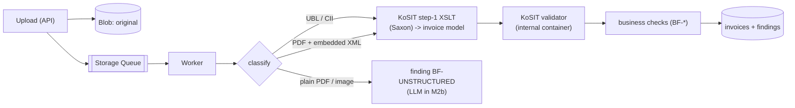
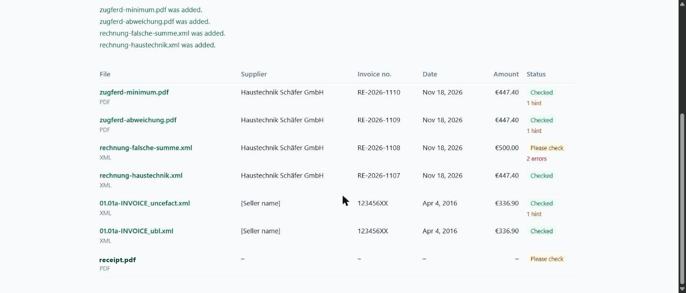
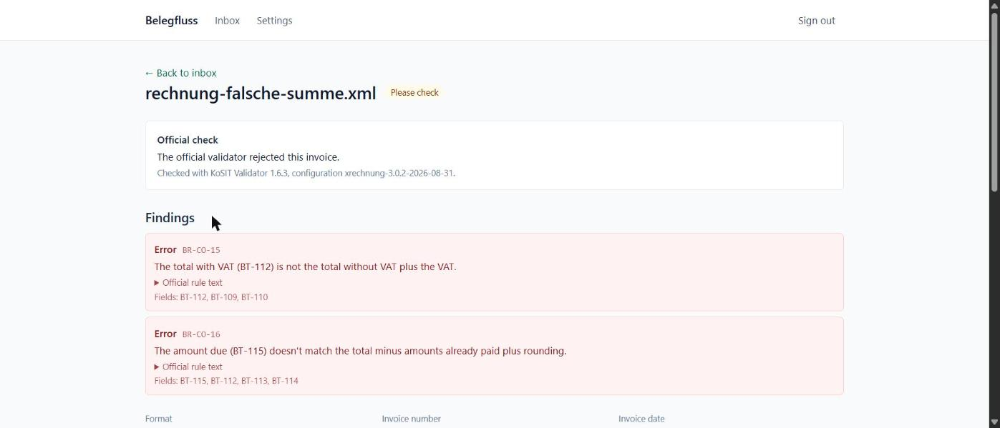
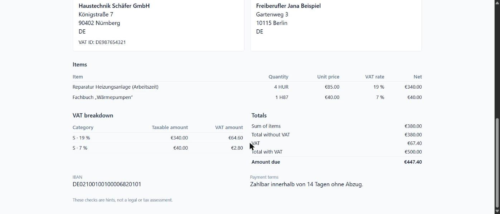
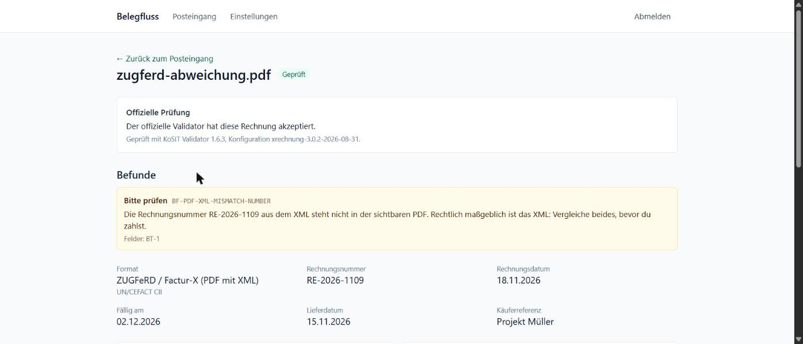
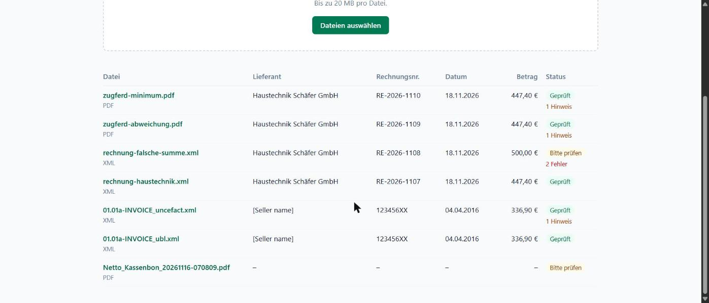
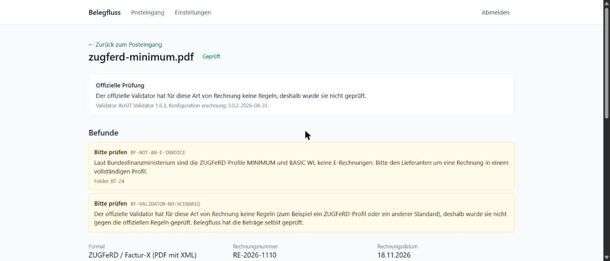

# M2a — Reading & validating invoices (deterministic part)

> Date: 2026-11-24 · Branch: `m2a-reading-validating` · [PR #7](https://github.com/LomadaDharmateja/belegfluss/pull/7)
> M2 was split into two PRs (decided 2026-11-24): **M2a** reads and checks structured e-invoices without any cloud
> service (€0). **M2b** adds LLM extraction for plain PDFs/photos, the review step and the export.

## Like I'm 10

Some bills come as computer files that only a computer can read. Belegfluss now reads them for you: who sent the
bill, what you bought, and how much you have to pay. Then it asks the official checking program of the German
government whether the bill follows the rules, and it does its own sums. If something is wrong, for example the
total doesn't add up, it tells you in simple German or English what is wrong and where. It also notices tricks
that are easy to miss: a PDF bill whose picture shows a different number than the computer part, or the same bill
arriving twice. All of this happens in the background, a few seconds after you drop the file.

## Technical

### How a document flows

| Part | What it does | Key files |
|---|---|---|
| Classify | By content: UBL Invoice/CreditNote, CII, PDF with embedded `factur-x.xml`/`zugferd-invoice.xml`/`xrechnung.xml` (pypdf), else unstructured. Untrusted XML: no network, no entities, DOCTYPE rejected; PDFs encrypted with an empty password are read | `reading/classify.py` |
| Read | Official KoSIT step-1 XSLT (vendored, Apache-2.0) via saxonche → intermediate XML with `xr:id="BT-…"` → Pydantic `InvoiceModel` named after EN 16931 terms ([ADR-0014](../decisions/0014-read-xml-with-official-kosit-transform.md)) | `reading/transform.py`, `reading/xr.py`, `reading/model.py`, `reading/xslt/` |
| Validate | KoSIT validator 1.6.3 + XRechnung configuration 2026-08-31 in its own container, not published. 200 accepted, 406 rejected, 406 + `noScenarioMatched` = not checked, 422 not processable, else retry ([ADR-0005](../decisions/0005-validator-as-internal-daemon.md)) | `services/validator/Dockerfile`, `validation.py` |
| Check | Plain functions, codes `BF-*`: profile (MINIMUM/BASIC WL), small amount (§ 33 UStDV), currency, German VAT rates, arithmetic (only when the validator didn't check), mandatory details (KoSIT table for § 14 Abs. 4 UStG), PDF vs. XML for ZUGFeRD, semantic duplicates | `checks.py` |
| Process | Storage Queue + worker: idempotent, sweeper for stuck documents, poison queue after 5 attempts ([ADR-0004](../decisions/0004-jobs-storage-queue-with-db-status.md)) | `queue.py`, `worker.py`, `pipeline.py` |
| Store | `invoices` (summary columns + full model as JSONB, versions) and `findings` ([ADR-0015](../decisions/0015-store-results-as-summary-columns-plus-jsonb.md)) | `models.py`, `migrations/versions/20261124_…` |
| Show | List with supplier, number, date, amount, status, finding counts (polls while processing). Document page: official result with versions, findings in plain DE/EN (official text on request), invoice rendered as text | `apps/web/src/components/` (`DocumentList`, `DocumentDetail`, `FindingsList`, `InvoiceView`) |

### Test results (evidence)

| Check | Result | Evidence |
|---|---|---|
| Spike: official XSLT on the 86-file suite | 86/86 transformed, 0 mismatches on BT-106/109/110/112/115, median 5 ms | [`xslt-spike-2026-11-24.txt`](../research/evidence/xslt-spike-2026-11-24.txt) |
| API: ruff, format, mypy strict, pytest | **202 passed** (incl. 86 suite files, 8 validator tests against the real container, 14 end-to-end pipeline tests) | CI [api](https://github.com/LomadaDharmateja/belegfluss/actions/runs/45330440458) |
| Web: lint, types, Vitest, Playwright | 37 unit + 5 browser tests passed | CI [web](https://github.com/LomadaDharmateja/belegfluss/actions/runs/45330440599) |
| Compose smoke | all healthy; worker running; validator reachable from the worker but **not** from the host | CI [compose-smoke](https://github.com/LomadaDharmateja/belegfluss/actions/runs/45330440554) |
| Secret scan | clean | CI [secret-scan](https://github.com/LomadaDharmateja/belegfluss/actions/runs/45330440559) |
| Validator sizing (dev laptop) | 512 MB heap: 627 MiB container; 256 MB heap: 3 × 86 files, all 200, 446 MiB, median 29 ms | [PROJECT_LOG](../PROJECT_LOG.md) (2026-11-24, M2a) |
| Manual walkthrough (signed in) | clean invoice → Checked; wrong total → Please check (BR-CO-15/16); ZUGFeRD with different visible number → hint; MINIMUM → "not checked" + not an e-invoice | screenshots below |

| | |
|---|---|
|  |  |
| Inbox: supplier, number, date, amount, status, counts | Wrong total: rejected, BR-CO-15/16 in plain English |
|  |  |
| Invoice rendered as text from the model | ZUGFeRD: visible PDF shows another invoice number |
|  |  |
| Inbox in German | MINIMUM: no official rules, our own checks ran |

### Changes from the plan

- **M2 split into M2a and M2b** (your decision before the start): smaller reviews, and the paid service starts later.
- **Official transform instead of our own parsers**, decided by the spike (ADR-0014). Credit notes are not in the
  official suite, so a synthetic one was written.
- **Validator heap stays at 512 MB.** 256 MB was enough for the suite, but large invoices with attachments were not
  tested. Sized again for Azure in M4.
- **Fourth validator outcome `no_scenario`**, found in the walkthrough (see below). ADR-0005 listed three.
- **Status rule:** `needs_review` when nothing could be read, when the validator rejected the invoice, or when any
  finding is an error. Warnings (e.g. PDF vs. XML, duplicate) keep `ready` but are counted in the list.
- **FeRD profile Schematron and PDF/A-3 checks** (optional in the plan) were not done.

### What broke and what I learned

1. **A real receipt was "password-protected".** It was encrypted with an *empty* password (only editing is
   restricted), like many real PDFs. Found on real data, fixed with a regression test: try the empty password first.
2. **MINIMUM invoices showed "rejected".** The XRechnung configuration has no scenario for them; the validator
   answers 406 with `noScenarioMatched`. Belegfluss said "rejected" and, believing the validator had checked the
   sums, skipped its own arithmetic. Now: "not checked", our arithmetic runs, and a real rejection always needs
   review. Found in the walkthrough, regression tests first.
3. **The newest Azure SDK speaks an API version Azurite doesn't list yet.** Tests now start Azurite like Compose:
   pinned 3.38.0 with `--skipApiVersionCheck`.
4. **Docker files downloaded by `ADD` are root-only (0600)**, so the non-root validator couldn't read its jar.
   Fixed in the image; the Docker SDK can't build `ADD --checksum` (BuildKit), so tests build with the docker CLI.
5. **Azure requires a visibility timeout of at least 1 second**; the poison test waits accordingly.

### What M2a can and cannot do

- **Can:** XRechnung 3.0.x and EN 16931 invoices and credit notes (UBL, CII), ZUGFeRD/Factur-X PDFs; official
  validation with versions stored; business checks incl. PDF-vs-XML; DE/EN explanations for all own codes and 22
  common official rules; background processing that survives crashes and retries.
- **Cannot yet:** read plain PDFs/photos (M2b); review, correct, approve, export (M2b); XRechnung 4.0 (expected
  2027); FeRD profile rules and PDF/A-3 checks; show unit codes as words ("HUR" instead of "hours"); email intake
  (M6).

## For interviews

**Say it in 7 sentences:**
1. "M2a reads German e-invoices exactly: XRechnung in both syntaxes and ZUGFeRD PDFs, into one model named after the
   EN 16931 business terms."
2. "Instead of writing two parsers, I ran a time-boxed spike with the standard publisher's own XSLT and Saxon. It read
   all 86 official test files with every total matching an independent XPath, so I adopted it and recorded why in an
   ADR."
3. "Validation uses the official KoSIT validator, unchanged, as an internal container that only the worker can
   reach, because the daemon has no authentication."
4. "Processing runs in a queue-based worker that is idempotent, has a sweeper for lost messages and a poison queue,
   and I tested each failure path."
5. "On top of the official rules, plain-code checks catch things users miss, like a ZUGFeRD PDF whose visible invoice
   number differs from the legally leading XML."
6. "Every finding is explained in German and English, and a test fails if the API introduces a code without both
   translations."
7. "Two bugs only showed up on real data: a receipt encrypted with an empty password, and invoices the validator had
   no rules for being shown as rejected. Both got regression tests before the fix."

**Likely questions and good answers:**

- **Why not your own parser?** Two syntaxes, ~50 business terms each, and a new XRechnung version in 2027. The
  official transform is maintained by KoSIT; the spike proved it on the official suite. The trade-off (a 35 MB Saxon
  wheel, undefined output for invalid input) is documented, and the validator result is always shown next to it.
- **How do you handle malicious XML?** Parse with lxml without network or entity resolution, reject any DOCTYPE
  (billion laughs, XXE), require UTF-8. Tests cover each attack. Invoice text is only ever rendered as React text.
- **What if the validator is down?** The worker treats it as transient: the message reappears after the visibility
  timeout. After five attempts the document is `failed` with a visible reason and the message is in the poison queue.
- **Why does the validator say "not checked" sometimes?** The official configuration has scenarios for XRechnung and
  EN 16931. A ZUGFeRD MINIMUM invoice matches none, which the report says explicitly. Treating that as "rejected"
  was a bug I found in the walkthrough.
- **Isn't the PDF-vs-XML check fragile?** It only looks for the invoice number and the total in the text layer, in
  German and English formats. A mismatch is a "please check" hint, not an error, because the XML is legally leading.
  Scans without text get "could not compare".
- **How do you avoid duplicate messages?** Our arithmetic runs only when the validator didn't check, and a missing
  detail the validator already reported (by business term) isn't repeated.

## Claims audit (end of M2a)

Scope: README, ARCHITECTURE (M2a parts), ADRs 0014–0015, THIRD_PARTY, COSTS, PLAN (M2), this document.

| # | Claim | Where | Status | Evidence / action |
|---|---|---|---|---|
| 1 | All 86 official test-suite files are read; key totals equal the XML | M2a, ADR-0014 | ✅ confirmed | `test_reading_suite.py` in CI (202 passed) |
| 2 | All 86 are accepted by the official validator; a wrong total is rejected with BR-CO-15 | M2a | ✅ confirmed | `test_validation.py` against the real container |
| 3 | XSLT transform ~5 ms per file | ADR-0014, M2a | ⚠️ caveat | One run on the dev laptop |
| 4 | Validator: 627 MiB at 512 MB heap; 256 MB enough for the suite; median ~30 ms | M2a | ⚠️ caveat | Dev laptop, official suite only, no large attachments |
| 5 | Validator not reachable from outside the Compose network | M2a | ✅ confirmed | compose-smoke CI step |
| 6 | DOCTYPE, billion laughs, XXE, non-UTF-8 rejected | M2a, ADR-0014 | ✅ confirmed | `test_reading_unit.py`, `test_pipeline.py` |
| 7 | Sweeper, poison queue, idempotent re-processing | M2a | ✅ confirmed | `test_pipeline.py`; sweeper also on real data |
| 8 | MINIMUM / BASIC WL are not e-invoices | messages, M2a | ✅ confirmed | Research F3 (BMF FAQ Q7, not binding; the text says "laut Bundesfinanzministerium") |
| 9 | Mandatory details follow § 14 Abs. 4 UStG via the KoSIT table | checks, M2a | ⚠️ caveat | Table read 2026-11-24 (dated July 2025, an "Orientierungshilfe"). We check a subset (no Nr. 9, 10). *Fixed during audit:* research F29 marked as read |
| 10 | Small amount ≤ €250: fewer details (§ 33 UStDV) | messages | ✅ confirmed | § 33 UStDV read 2026-11-24 |
| 11 | Curated rule explanations match the official rules | messages | ✅ confirmed | Rule texts extracted from the configuration 2026-08-31; 22 codes |
| 12 | PDFs encrypted with an empty password are read | M2a | ✅ confirmed | Regression test; the real receipt |
| 13 | No file names or invoice content in logs | worker, M2a | ⚠️ caveat | Worker logs IDs and error types only (code + observed logs); Azure SDK logging limited to warnings. No automated test yet (M5) |
| 14 | saxonche is MPL-2.0; vendored XSLT is Apache-2.0 | THIRD_PARTY, ADR-0014 | ✅ confirmed | Saxonica product page; LICENSE copied from the tag |
| 15 | gpt-5-mini (2025-08-07) is available as Data Zone Standard EU in Germany West Central | COSTS, PLAN | ✅ confirmed | [Region availability](https://learn.microsoft.com/en-us/azure/foundry/foundry-models/concepts/models-sold-directly-by-azure-region-availability), page updated 2026-10-19, read 2026-11-24 |
| 16 | gpt-5-mini Data Zone price $0.275 / $2.20 per 1M tokens | COSTS | ✅ confirmed | Azure Retail Prices API, 2026-11-24 |
| 17 | M2b development costs about €2–4 | COSTS, PLAN | ⚠️ caveat | Estimate from assumed tokens per document; measured in M2b |
| 18 | M2a cloud cost €0 | COSTS | ✅ confirmed | No Azure resource created in M2a |
| 19 | All links in the changed docs resolve; diagrams render | all | see below | Recorded below |

## Next

- Review ADR-0014 and ADR-0015 (Proposed), then merge PR #7.
- M2b plan: LLM extraction (gpt-5-mini, EU Data Zone), review step, export. Needs your Azure CLI install and a yes
  before the Azure OpenAI resource is created.
