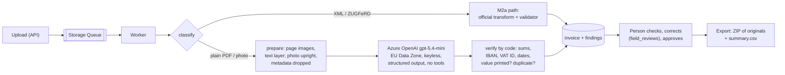
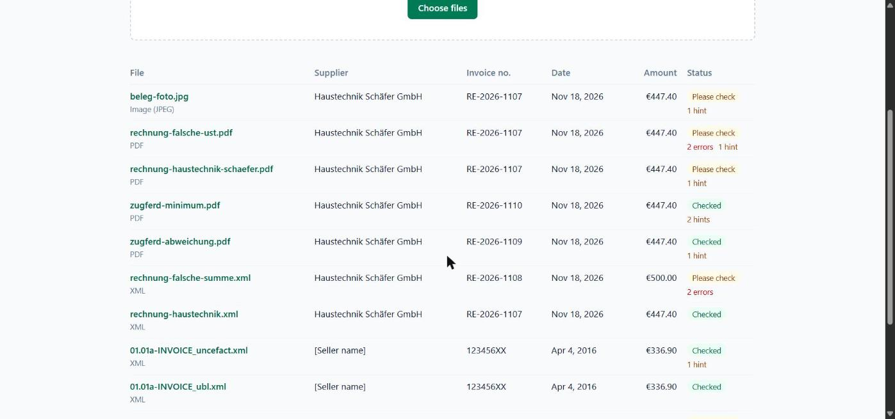
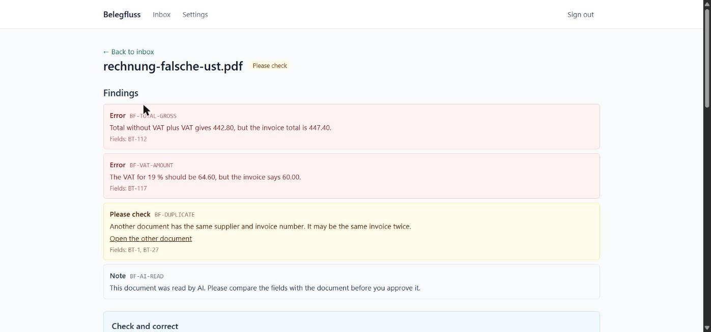
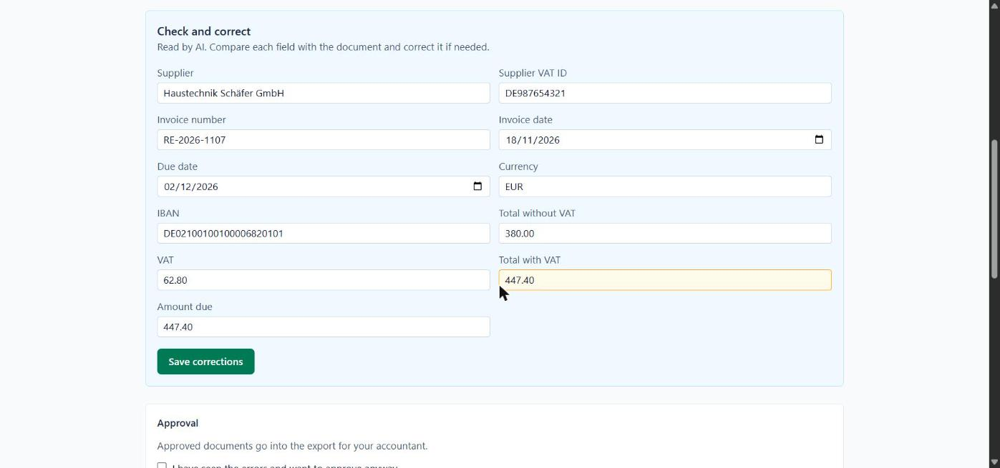

# M2b — AI reading, review, approval and export

> Date: 2026-11-25 · Branch: `m2b-ai-review-export` · PR: see PLAN.md
> M2 was split into two PRs: **M2a** reads and checks structured e-invoices; **M2b** (this one) reads plain PDFs and
> photos with AI, lets a person check and approve, and exports for the accountant. First paid cloud service.

## Like I'm 10

Some bills are just pictures: a PDF without any computer data inside, or a photo of a receipt. Belegfluss now asks an
AI to read them: who sent the bill, the number, the date and the amounts. But we don't simply trust the AI. The
computer adds up the numbers again, checks that the bank account number is valid, and looks whether the values are
really printed on the bill. Even if everything looks fine, a person has to look at it and press "Approve". If the AI
read something wrong, you fix it, and Belegfluss remembers what was changed and by whom. At the end of the month you
download one ZIP file for your accountant: the original bills, unchanged, plus a table that opens in Excel.

## Technical

### How a plain PDF or photo flows

| Part | What it does | Key files |
|---|---|---|
| Prepare | PDF: first 3 pages at 150 dpi (≤ 1,600 px PNG) + text layer. Photo: EXIF rotation, ≤ 2,048 px, re-encoded JPEG (drops GPS and other metadata), pixel limit against decompression bombs | `extraction/prepare.py` |
| Extract | Responses API on the Azure v1 endpoint, `responses.parse` with a strict Pydantic schema (amounts and dates as strings, parsed by code), reasoning `low`, `store=False`, no tools, document marked as untrusted; keyless via `DefaultAzureCredential` ([ADR-0016](../decisions/0016-ai-extraction-azure-openai-verified-by-code.md)) | `extraction/azure_openai.py`, `extraction/schema.py` |
| Verify | Existing arithmetic and mandatory-detail checks plus `BF-AI-*`: IBAN checksum, VAT ID shape, plausible dates, number/VAT ID/IBAN/total present in the text layer (amounts compared as numbers); duplicate lookup | `extraction/verify.py`, `checks.py`, `pipeline.py` |
| Fail safely | Network, 408/409/429/5xx → queue retry; other errors → `BF-AI-FAILED`; not an invoice → `BF-AI-NOT-AN-INVOICE`; AI off → `BF-UNSTRUCTURED` | `pipeline.py`, `worker.py` |
| Review | Correct AI-read fields only (XML is legally leading); each change stored before/after in `field_reviews`; checks re-run without another AI call ([ADR-0017](../decisions/0017-review-approval-and-export.md)) | `review.py`, `routes/documents.py`, `ReviewForm.tsx` |
| Approve | From ready/needs_review; open errors need an explicit acknowledgement (checkbox), audited as `document.approved_with_errors`; reopen possible | `review.py`, `ApprovalBox.tsx` |
| Export | Approved documents by invoice date → ZIP of byte-identical originals + `summary.csv` (UTF-8 BOM, `;`, comma decimals, DD.MM.YYYY, VAT per rate, open findings, CSV-injection guard); 500 documents / 200 MB limit | `export.py`, `routes/export.py`, `ExportBox.tsx` |
| Run locally with AI | `compose.ai.yaml` (no container worker, validator on 127.0.0.1) + `scripts/run-ai-worker.ps1` (worker on the host with `az login`) | [setup guide](../setup/azure-openai-dev.md) |
| Azure | `scripts/azure/dev-openai.ps1`: resource group, Azure OpenAI S0 with custom domain, keys off (read back), deployment, role on this resource only | `scripts/azure/` |

### Test results (evidence)

| Check | Result | Evidence |
|---|---|---|
| API: ruff, format, mypy strict, pytest | **243 passed**, 1 skipped (the opt-in live test). Includes 19 extraction unit tests, 8 AI pipeline tests with a fake model, 14 review/export tests | local run 2026-11-25; CI on the PR |
| Web: lint, types, Vitest, build, Playwright | 47 unit + 5 browser tests passed, build OK | local run 2026-11-25; CI on the PR |
| Live run against Azure (4 synthetic documents) | all fields right; misprinted VAT → `BF-VAT-AMOUNT`; injected instruction ignored; photo read like the PDF; $0.0172 in total | [m2b-live-run-2026-11-24.md](evidence/m2b-live-run-2026-11-24.md) |
| Azure resource read back | keys off, Data Zone Standard, capacity 20, role only on this resource, nothing else in the group | [PROJECT_LOG](../PROJECT_LOG.md) (2026-11-24, steps 3–4) |
| Manual walkthrough (signed in, synthetic files) | 3 files read by AI in seconds; wrong VAT → 2 errors; same invoice → duplicate hint; a correction stored before/after and audited; approve with and without acknowledgement; export: 2 approved originals byte-identical, CSV with BOM and open findings | screenshots below, [PROJECT_LOG](../PROJECT_LOG.md) (2026-11-25) |

**M2 acceptance criteria (PLAN):**
1. All 86 official files parsed ✅ (M2a).
2. Totals equal the XML ✅ (M2a).
3. Validator results as expected ✅ (M2a).
4. A synthetic plain PDF goes end to end through AI extraction, and a wrong field is caught and routed to review ✅
   (`test_wrong_printed_vat_is_caught_by_verification` with the fake, and the live run).
5. Exported originals byte-identical, CSV with umlauts ✅
   (`test_export_contains_only_approved_originals_unchanged_and_a_german_csv`, and the walkthrough export).

| | |
|---|---|
|  |  |
| Inbox: two plain PDFs and a photo, read by AI, waiting for a person | Plain PDF with a misprinted VAT amount: caught by the arithmetic, plus a duplicate hint |
|  | |
| Check and correct: the field behind an error is highlighted | |

### Changes from the plan

- **Model: gpt-5.4-mini instead of gpt-5-mini.** The subscription had **0** EU Data Zone quota for gpt-5-mini in
  seven EU regions. gpt-5.4-mini had quota, retires later (2027-09-21 vs 2027-07-13) and costs about 2.5× per token.
  Decided with you before anything was created (ADR-0016, COSTS).
- **One more Azure step:** the subscription first needed the `Microsoft.CognitiveServices` provider registered (free).
- **The audit log records actions only** (`invoice.corrected`). The plan said "field names only"; the field names and
  values are in `field_reviews`, which is customer data like the invoice.
- **No `EXPORT` table:** the ZIP is built on request and not stored; `export.created` is audited.
- Component name: `ApprovalBox.tsx` instead of `ApproveButton.tsx` (it holds the checkbox, button, state and reopen).

### What broke and what I learned

1. **"0,00" was found inside "340,00".** The presence check compared amounts as text fragments, so an injected total
   of 0.00 looked "printed". Found by the prompt-injection test. Amounts are now read from the text as whole numbers;
   the ZUGFeRD PDF-vs-XML check had the same weakness and uses the same fix.
2. **A correction hid the duplicate warning.** The re-check after a correction ran without the duplicate lookup, so
   the same invoice could have been approved and exported twice. Found in the walkthrough; regression test first.
3. **Times were shown in UTC.** The web container runs in UTC and no time zone was set, so an approval at 03:34 in
   Germany showed 2:34. Now `Europe/Berlin` explicitly. Found in the walkthrough; regression test first (the first
   version of the test passed by accident on a German laptop, so it now checks the setting itself).
4. **"Offered in a region" is not "usable".** The region table and `model list` showed gpt-5-mini, but the quota was 0.
   Check `az cognitiveservices usage list` before planning a model.
5. **`az login` skipped the subscription's directory** because it needs multi-factor sign-in; `az login --tenant`
   fixed it.
6. **A worker on the host is fragile:** after a restart Docker and the worker were gone. Fine for development; in M4
   the worker runs in Azure with a Managed Identity.

### What M2b can and cannot do

- **Can:**
  - read plain PDFs (up to 3 pages) and photos into the same invoice model as XML
  - check every AI-read value by code, catch misprinted VAT and wrong totals, flag values that aren't printed
  - let a person correct AI-read fields, with before/after kept
  - approve, with a recorded override when errors are open
  - export a ZIP of unchanged originals plus a CSV that opens in German Excel
- **Cannot yet:**
  - measured accuracy on many documents (M3)
  - more than 3 pages per document for AI
  - guarantees for handwriting or very poor photos
  - corrections of single invoice lines (header fields and totals only)
  - DATEV format (only if accountants ask, ADR-0009)
  - automatic email intake or scheduled exports (M6)
  - AI reading in the Compose worker without the host setup (Managed Identity in M4)

## For interviews

**Say it in 7 sentences:**
1. "M2b reads invoices that have no machine-readable data, plain PDFs and phone photos, with Azure OpenAI in the EU
   data zone, and turns them into the same invoice model as the official XML path."
2. "The model never decides anything: code re-checks the sums, the IBAN checksum, the VAT ID and dates, looks whether
   each value is really printed in the PDF, and every AI-read document waits for a person."
3. "Access is keyless: keys are switched off on the resource, and the worker signs in with Entra ID, my CLI login
   locally and a Managed Identity in Azure."
4. "I treat the document as untrusted input: no tools, output is data only, and a prompt-injection test shows the
   arithmetic would catch an obeyed instruction."
5. "Corrections are stored as before and after, approving despite errors needs an explicit, audited acknowledgement,
   and the accountant export contains the untouched originals plus an Excel-friendly CSV."
6. "Before creating anything in Azure I checked quota read-only, found the planned model had none in the EU, and
   switched models with a recorded decision instead of falling back to a global deployment."
7. "The first live run cost about four tenths of a cent per document, and the walkthrough found two real bugs, a lost
   duplicate warning and UTC times, each fixed with a regression test first."

**Likely questions and good answers:**

- **Why not trust the model's confidence?** Self-reported confidence is not calibrated. Code checks are: if net plus
  VAT doesn't give the total, something is wrong no matter how sure the model is. M3 measures how often the checks
  catch a wrong field.
- **How do you handle prompt injection?** The model has no tools and no data access, its output goes through a strict
  schema, and the values are checked by code and by a person. The worst case is a wrong value that the arithmetic or
  the presence check flags. There's a test that assumes the model obeyed.
- **Why images and text, not just one?** Images work for photos and scans; the text layer lets code verify that a
  value is really printed, which is cheap and catches hallucinations.
- **Why gpt-5.4-mini?** EU Data Zone quota was available now, it retires later than gpt-5-mini, and measured cost is
  still about $0.004 per document. The model is a setting, and the M3 eval set will make the next switch a measured
  decision.
- **Why can't users correct XML invoices?** For e-invoices the XML is the legal document. If it's wrong, the supplier
  must send a corrected invoice; Belegfluss explains the problem instead of silently changing data.
- **Why allow approving with errors?** A supplier's rejected XRechnung may still have to go to the accountant. The
  override is explicit, audited, and the CSV shows the open findings.
- **How is CI kept free of paid calls?** The extractor is an interface. CI uses a fake; one live test runs only when an
  endpoint is set, and it costs about two cents.

## Claims audit (end of M2b)

Scope: README, ARCHITECTURE (M2b parts), ADRs 0016–0017, COSTS, THIRD_PARTY, PLAN (M2), setup guide, this document.

| # | Claim | Where | Status | Evidence / action |
|---|---|---|---|---|
| 1 | AI-read documents always end in "needs review" | M2b, ADR-0016, ARCHITECTURE | ✅ confirmed | `test_plain_pdf_is_read_by_ai_and_waits_for_a_person`; walkthrough |
| 2 | A misprinted VAT amount is caught by code | M2b, README, ADR-0016 | ✅ confirmed | Fake-model test and live run |
| 3 | An injected instruction is ignored, and caught by arithmetic if obeyed | M2b, ADR-0016 | ⚠️ caveat | Live: one sample. Obeyed case: test with the fake. Not a general robustness guarantee |
| 4 | About $0.0043 per document | M2b, COSTS, README, ADR-0016 | ⚠️ caveat | 4 synthetic one-page documents; tokens × list price, not an Azure invoice |
| 5 | 2.4–5.7 s per document | ADR-0016 | ⚠️ caveat | One run on the dev laptop, includes the first sign-in |
| 6 | Keys switched off; access keyless | M2b, ADR-0016, setup | ✅ confirmed | `disableLocalAuth = true` read back; log line `DefaultAzureCredential acquired a token from AzureCliCredential` |
| 7 | Data Zone Standard EU, Germany West Central, capacity 20 | M2b, COSTS, ARCHITECTURE | ✅ confirmed | `az cognitiveservices account deployment show` |
| 8 | gpt-5-mini had 0 EU Data Zone quota; gpt-5.4-mini 200 | ADR-0016, COSTS, ARCHITECTURE | ✅ confirmed | `az cognitiveservices usage list`, 2026-11-24 (this subscription only) |
| 9 | gpt-5.4-mini Data Zone price $0.825 / $4.95 per 1M tokens | COSTS, ADR-0016 | ✅ confirmed | Azure Retail Prices API, 2026-11-24 |
| 10 | Retirement dates 2027-07-13 (gpt-5-mini) and 2027-09-21 (gpt-5.4-mini) | ADR-0016, M2b | ✅ confirmed | `az cognitiveservices model list`, `deprecation.inference` |
| 11 | gpt-5.4-mini supports image input and structured outputs | ADR-0016 | ⚠️ caveat | Models page and reasoning page say yes; the structured-outputs page doesn't list it yet; the live run worked |
| 12 | Capacity 20 = 20,000 tokens per minute, not a fixed cost | setup, script | ⚠️ caveat | Quota guide states the unit for Standard; Data Zone Standard is pay-per-token per the deployment-types page |
| 13 | No monthly base fee | COSTS, setup | ⏳ unverified | Azure cost view lags by up to a day: check on the next session and record in COSTS |
| 14 | Photo metadata (GPS) is dropped | M2b, ADR-0016 | ✅ confirmed | `test_photos_are_turned_upright_shrunk_and_stripped_of_metadata` |
| 15 | Exported originals byte-identical; CSV with BOM, `;`, comma decimals, umlauts | M2b, ADR-0017, README | ✅ confirmed | Export test; walkthrough ZIP compared by SHA-256 |
| 16 | CSV cells cannot become formulas | ADR-0017 | ✅ confirmed | `test_csv_cells_from_invoices_cannot_become_formulas` |
| 17 | CI makes no paid calls | ADR-0016, M2b | ✅ confirmed | Endpoint empty by default; live test skipped in the suite output |
| 18 | No invoice content in logs | ADR-0016, ARCHITECTURE | ⚠️ caveat | Worker logs IDs and error types; Azure SDK at warning; HTTP library logs URL and status only (seen in the live run). No automated test yet (M5) |
| 19 | Times are shown in German time | M2b | ✅ confirmed | `timezone.test.ts`; walkthrough shows 3:34 for an approval at 03:34 |
| 20 | Correcting a field keeps the duplicate warning | M2b, ADR-0017 | ✅ confirmed | `test_a_correction_keeps_the_duplicate_warning`; walkthrough |
| 21 | M2b development costs about $0.65 | COSTS | ⚠️ caveat | Estimate: ~150 runs × measured cost per document |
| 22 | Licences: openai Apache-2.0, azure-identity MIT, Pillow MIT-CMU | THIRD_PARTY | ✅ confirmed | Installed package metadata |
| 23 | All links in the changed docs resolve; diagrams render | all | ⚠️ caveat | 2026-11-25: 111/111 relative links and anchors resolve, 46/46 public web links return 2xx/3xx. Diagram rendering on GitHub still to be looked at on the PR |

## Next

- You: review ADR-0016 and ADR-0017 and the PR.
- Check the Azure cost view for a base fee (claim 13).
- M3: labelled evaluation set, field-level accuracy, Document Intelligence baseline, CI gate.
