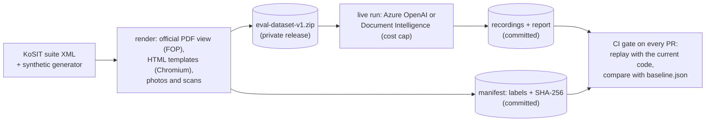

# M3 — Evaluation & quality gates

> Date: 2026-11-25 · Branch: `m3-eval-gates` · [PR #11](https://github.com/LomadaDharmateja/belegfluss/pull/11)
> M2b made AI reading work on 4 samples. M3 measures it on 206 labelled documents, compares it with Azure Document
> Intelligence, and adds a CI gate that blocks changes that make it worse.

## Like I'm 10

Before, we only knew the AI read four test bills correctly. Now we built a big pile of practice bills: about 200,
where we know every right answer in advance. Some are official test bills from the German government, some we made
up ourselves in different looks, and some are photos and scans. We let the AI read them all and counted how often it
got everything right. While practising we found and fixed mistakes: it thought till receipts weren't bills. Then we
tested once on bills it had never seen: 72 % were completely right, and almost every single number was right. We also
saved its answers. Now every time someone changes the code, a robot replays those answers. If the score gets worse,
the change isn't allowed in.

## Technical

### How the evaluation works

| Part | What it does | Key files |
|---|---|---|
| Official set | 86 KoSIT suite files: our exact XML reader gives the labels; the official `xr-pdf.xsl` + Apache FOP 2.12 give the PDF in four looks | `eval/src/belegfluss_eval/dataset/official.py`, `eval/fop/Dockerfile` |
| Synthetic set | 80 seeded fictional invoices in 4 templates (letter, Handwerk, English freelancer, till receipt), amounts computed with Decimal and checked by our own arithmetic | `dataset/synthetic.py`, `eval/templates/` |
| Variants | 20 phone photos (perspective, light, blur, noise) and 20 image-only scans of page 1 | `dataset/variants.py` |
| Manifest | labels + SHA-256 per file, split by source document (dev 79 / test 127); its hash is the dataset version | `eval/dataset/manifest.json` |
| Runner | live run with cost cap; keyless sign-in; records every answer, the text layer, tokens and seconds | `runner.py`, `extractors.py`, `recording.py` |
| Scoring | the production mapping and checks (`to_invoice_model`, `check_invoice`, `check_ai_invoice`); 14 fields, strict | `scoring.py`, `metrics.py` |
| Gate | replays the baseline run with the current code; fails on lower numbers, a changed prompt fingerprint or a changed dataset | `gate.py`, `eval/baseline.json`, `.github/workflows/eval.yml` |
| Live from GitHub | manual workflow, OIDC sign-in with a managed identity that trusts only the `eval` environment on `main` | `.github/workflows/eval-live.yml`, [ADR-0019](../decisions/0019-ci-to-azure-with-oidc-managed-identity.md) |

**Definitions (stated next to every number):**
- **Document accuracy:** every export field right (number, dates, currency, seller name + VAT ID, buyer, IBAN,
  net, VAT, gross, due, VAT breakdown).
- **Line count** is reported on its own: the AI sees 3 pages at most.
- **Catch rate:** wrong documents that got a reading-verification finding (formats, sums, presence, VAT-rate
  plausibility).
- **False alarm:** a correct document that got one.
- **Conventions:** "no VAT" written as 0.00 or left out is the same; placeholders in the official files
  ("[Seller name]") count as empty.

### Results (evidence)

**Held-out test split: 127 documents, run once with the final prompt** ([report](../../eval/reports/test-final.md)):

| | gpt-5.4-mini (low effort, image + text) |
|---|---|
| **Document accuracy** | **71.7 %** (95 % CI 63.3–78.8 %) |
| Fields | number 96.9 %, issue date 99.2 %, due date 93.7 %, gross 96.1 %, due 96.1 %, VAT breakdown 95.3 %, IBAN 89.0 %, seller VAT ID 83.5 % |
| False alarms | 1.1 % |
| Catch rate | 16.7 % |
| Cost per document | $0.0054 |
| Seconds per document, p50 / p95 | 2.9 / 5.5 |

**By source and variant (test):**

| Group | Documents | Document accuracy | 95 % CI |
|---|---:|---:|---|
| synthetic, original | 52 | **92.3 %** | 81.8–97.0 % |
| synthetic, scan | 7 | 85.7 % | 48.7–97.4 % |
| synthetic, photo | 7 | 57.1 % | 25.0–84.2 % |
| official view, original | 48 | 68.8 % | 54.7–80.1 % |
| official view, photo | 6 | 0.0 % | 0.0–39.0 % |
| official view, scan | 7 | 0.0 % | 0.0–35.4 % |

The official KoSIT view is dense and prints the seller's VAT ID only in the page header, joined to the invoice
number. That, and its small print on photos and scans, is where most errors are. Synthetic layouts look more
like real small-business invoices and are read well. Small groups have wide intervals: read them as tendencies.

**Compared with Azure Document Intelligence `prebuilt-invoice` (API 2024-11-30, F0), same 127 test documents,
same scoring and verification** ([report](../../eval/reports/test-final.md)):

| | **gpt-5.4-mini + code checks** | Document Intelligence |
|---|---:|---:|
| Document accuracy | **71.7 %** (63.3–78.8 %) | 47.2 % (38.8–55.9 %) |
| Documents with ≤ 2 pages (all DI F0 reads) | **75.5 %** | 59.2 % |
| Synthetic originals / official view originals | **92.3 % / 68.8 %** | 80.8 % / 16.7 % |
| Seller VAT ID / IBAN / VAT breakdown | **83.5 / 89.0 / 95.3 %** | 66.1 / 78.7 / 84.3 % |
| Number / issue date / VAT / due | 96.9 / 99.2 / 96.1 / 96.1 % | 96.9 / 99.2 / 95.3 / **96.9 %** |
| Cost per document | **$0.0054** | $0.0140 (S0 price; F0 is free) |
| Seconds per document, p50 / p95 | **2.9 / 5.5** | 7.3 / 12.4 |

Two mapping rules give Document Intelligence the same chance as our reader: it also gets "no printed amount due →
the total is due", and its tax entries without a rate (each tax is reported twice) are ignored. Without them it
scored 3.1 %, an artefact of our mapping, not of its reading. The intervals don't overlap, so the difference is real
*on this set*. Document Intelligence is close on the simple synthetic layouts and weak on the dense official view.
It is a pre-trained service with a fixed field set; our reader can be told what each field means (payee IBAN,
receipts).

**Dev split: what changed and why** ([report](../../eval/reports/dev-prompt-v2.md),
[ablations](../../eval/reports/dev-ablations.md)). The numbers below are all scored with the final mapping code.

| Dev run (79 documents) | Document accuracy | Cost / document |
|---|---:|---:|
| Prompt v1 | 65.8 % | $0.0053 |
| **Prompt v2** (receipts are invoices; IBAN = payee account) | **77.2 %** | $0.0055 |
| Prompt v2, reasoning effort medium | 73.4 % | $0.0090 |
| Prompt v2, images only (no text layer) | 62.0 % | $0.0054 |

**Gate demo:** [PR #10](https://github.com/LomadaDharmateja/belegfluss/pull/10) "simplified" amount parsing to
German notation. In the [eval run](https://github.com/LomadaDharmateja/belegfluss/actions/runs/45550713154)
document accuracy fell to 3.1 % (net 95.3 % → 5.5 %), so the gate failed and the PR was closed unmerged.

| Check | Result | Evidence |
|---|---|---|
| Eval: ruff, format, mypy strict, pytest, gate | 20 unit tests + gate passed | CI on the PR |
| API: full suite | 245 passed, 1 skipped (live) | CI on the PR |
| Dataset fetch | release downloaded, 206/206 checksums match | local run 2026-11-25 |
| Azure resources read back | capacity 100; DI F0 keys off; federated subject `…:environment:eval`; CI roles on 2 single resources | [PROJECT_LOG](../PROJECT_LOG.md) 2026-11-25 |

### Changes from the plan

- **Prompt v2 and a code rule for the amount due**, found on dev and logged. Both are product fixes, not only
  evaluation fixes: till receipts were dropped, and exports lacked the amount due.
- **Two metric conventions** added after the first trial (placeholders, "no VAT"). They are documented in
  ADR-0018 and the code, and the same for every run.
- **Line count left out of document accuracy:** the official view puts line details on pages beyond the 3-page
  limit.
- **`photo_of` was not moved:** the evaluation needed a more realistic photo variant of its own.
- **`eval-live` can only run from `main`** (environment rule), so its first run from GitHub follows the merge.
- **No HTML report:** Markdown renders on GitHub, and JSON holds the numbers.

### What broke and what I learned

1. **Till receipts were answered as "not an invoice"**, so the worker would have dropped them. The prompt now names
   receipts explicitly. Found on dev.
2. **Most invoices print one total and no "amount due"**, and the model correctly didn't calculate it. Code now
   derives it (EN 16931 BT-115), with a regression test.
3. **The first trial scored 0 %** because of placeholders in the official files. Learned: look at the wrong fields
   before believing a number.
4. **The synthetic build wasn't repeatable** (an unseeded Faker); a test now checks it.
5. **More reasoning didn't help:** medium effort was worse, 64 % dearer and twice as slow. The text layer was worth
   +15 points for free.
6. **Missing values dominate the errors**, and code can't verify a value that wasn't read, so the catch rate is low
   (16.7 %). Mandatory-detail hints still tell the user when, for example, a VAT ID is missing.
7. **CI order matters:** on the demo PR the unit tests failed first and hid the gate's numbers. The gate step now
   always runs.

### What M3 can and cannot do

- **Can:**
  - honest field-level numbers with confidence intervals on a reproducible set
  - a measured cost/latency/accuracy comparison
  - a free, secret-free gate on every PR
  - forced live re-evaluation when the prompt, model settings or dataset change
  - live runs from GitHub without any secret
- **Cannot:**
  - real-world accuracy: official renders and synthetic layouts are cleaner than real mail; real pilot invoices
    only with consent (M5)
  - handwriting
  - Document Intelligence beyond 2 pages on F0
  - noticing model drift between live runs (rerun on demand)

## For interviews

**Say it in 7 sentences:**
1. "I built an evaluation set of 206 invoices with exact labels: the official German XRechnung test files rendered
   with the official PDF viewer, my own synthetic layouts, and photo and scan variants."
2. "It's split by source document into dev and a held-out test set, so tuning on dev can't leak into the reported
   number."
3. "On the held-out set gpt-5.4-mini reads 72 % of documents completely right, with a 95 % interval of 63–79 %, for
   half a cent per document. Single fields like the total are right about 96 % of the time. Azure Document
   Intelligence scored 47 % on the same set, at more than twice the cost."
4. "The dev runs found two real product bugs, receipts rejected as 'not an invoice' and a missing amount due, and
   fixing them moved dev accuracy from 56 to 77 %."
5. "Ablations showed more reasoning effort made it worse and 64 % more expensive, while sending the PDF's text layer
   with the images was worth 15 points for free."
6. "Every PR replays the recorded answers through the current code, so a parsing regression fails CI for free. If
   the prompt or model changes, a fingerprint forces a new live evaluation."
7. "Live evaluations can run from GitHub without any secret: OIDC with a managed identity that only trusts one
   environment on main."

**Likely questions and good answers:**

- **Why not run the LLM on every PR?** Cost, flakiness and secrets in PRs. Replaying recordings tests our code
  deterministically. The prompt fingerprint makes sure the recordings still describe what the model would see.
- **Isn't synthetic data cheating?** Partly cleaner, yes: I say it's an upper bound. That's why the official
  renders exist (layouts I didn't design), why photos and scans are included, and why real consented pilot data
  comes in M5.
- **Why is the catch rate so low?** Most errors are values the model left empty, and code can't check a value it
  doesn't have. The model invents almost nothing (false alarms 1 %), which is the dangerous kind of error.
- **Why Wilson intervals?** With about 100 documents a plain percentage looks more exact than it is. The interval
  shows the honest range.
- **How do you avoid overfitting the prompt?** Changes only on dev, each logged with its reason, and one run on
  test per prompt version. I also stopped tuning when the remaining errors were layout-specific.
- **Why not just use Document Intelligence?** I measured it on the same 127 documents with the same scoring: 47 %
  vs 72 % document accuracy, 2.6× the price per document on the paid tier, and 2.5× slower. It is close on simple
  layouts and weak on dense ones. I also checked my own mapping before trusting its first score of 3 %: two
  mapping rules were unfair to it, and I fixed them.

## Claims audit (end of M3)

Scope: README, ARCHITECTURE (M3 parts), ADRs 0018–0019, COSTS, THIRD_PARTY, PLAN (M3), setup guide, this document.

| # | Claim | Where | Status | Evidence / action |
|---|---|---|---|---|
| 1 | 206 documents, dev 79 / test 127, split by source | M3, ADR-0018 | ✅ confirmed | `manifest.json`; build output |
| 2 | Official labels come from our exact reader, proven on the suite | M3, ADR-0018 | ✅ confirmed | M2a suite tests; `official.py` uses `read_invoice` |
| 3 | Synthetic labels add up and generation is repeatable | M3 | ✅ confirmed | `test_dataset.py` |
| 4 | Every dataset file matches its SHA-256 after download | M3, setup | ✅ confirmed | `fetch` run: 206/206 |
| 5 | Test document accuracy 71.7 % (95 % CI 63.3–78.8 %) | M3, README | ✅ confirmed | `eval/reports/test-final.md`, `baseline.json` |
| 6 | $0.0054 per document, p50 2.9 s | M3, COSTS | ⚠️ caveat | Tokens × list price; one run on the dev laptop |
| 7 | Dev 65.8 % → 77.2 % with prompt v2 | M3 | ✅ confirmed | `dev-prompt-v2.md` (both runs scored with the same code) |
| 8 | Effort medium 73.4 % at $0.0090; images only 62.0 % | M3, ADR-0016 context | ⚠️ caveat | Dev split, one run each |
| 9 | The gate blocks a regression | M3, ADR-0018 | ✅ confirmed | PR #10, eval run 45550713154 |
| 10 | The gate needs no secrets and makes no paid calls | ADR-0018 | ✅ confirmed | `eval.yml` (no Azure step, `contents: read`) |
| 11 | Live runs from GitHub sign in without a secret, only from `eval` on `main` | ADR-0019, M3 | ⚠️ caveat | Federated subject and branch policy read back; first `eval-live` run follows the merge |
| 12 | CI identity has roles only on the two resources | ADR-0019 | ✅ confirmed | `az role assignment list` 2026-11-25 |
| 13 | M3 AI spend about $2.72 | COSTS | ⚠️ caveat | Tokens × list price; cost view to be checked |
| 14 | Document Intelligence F0 is free (500 pages/month, first 2 pages) | COSTS, ADR-0018 | ✅ confirmed | Service limits page, pricing page (read 2026-11-25) |
| 15 | Licences of FOP, Playwright, Jinja2, Faker, DI SDK | THIRD_PARTY | ✅ confirmed | Package metadata / project pages |
| 16 | Real-world accuracy is not measured | M3, ADR-0018 | ✅ confirmed (as a limit) | stated in every report context |
| 17 | Document Intelligence 47.2 % vs ours 71.7 % on the same test set | M3, README | ⚠️ caveat | `test-final.md`; F0 reads 2 pages (≤ 2-page subset reported: 59.2 % vs 75.5 %); two fairness rules in `read_di` with a test |
| 18 | Document Intelligence costs $0.014 per document | M3 | ⚠️ caveat | S0 list price $10 per 1,000 pages × pages read (max 2); F0 used was free |
| 19 | All links in the changed docs resolve; diagrams render | all | ⚠️ caveat | 2026-11-25: 121/121 relative links and anchors, 45/45 public web links, 3/3 private repo links (via `gh api`). Diagram rendering on GitHub to be looked at on the PR |

## Next

- You: review ADR-0018 and ADR-0019 and the PR.
- After the merge: run `eval-live` once from GitHub (OIDC) and link it here.
- M4: Azure with Terraform. The resources created by scripts so far get imported or recreated.
